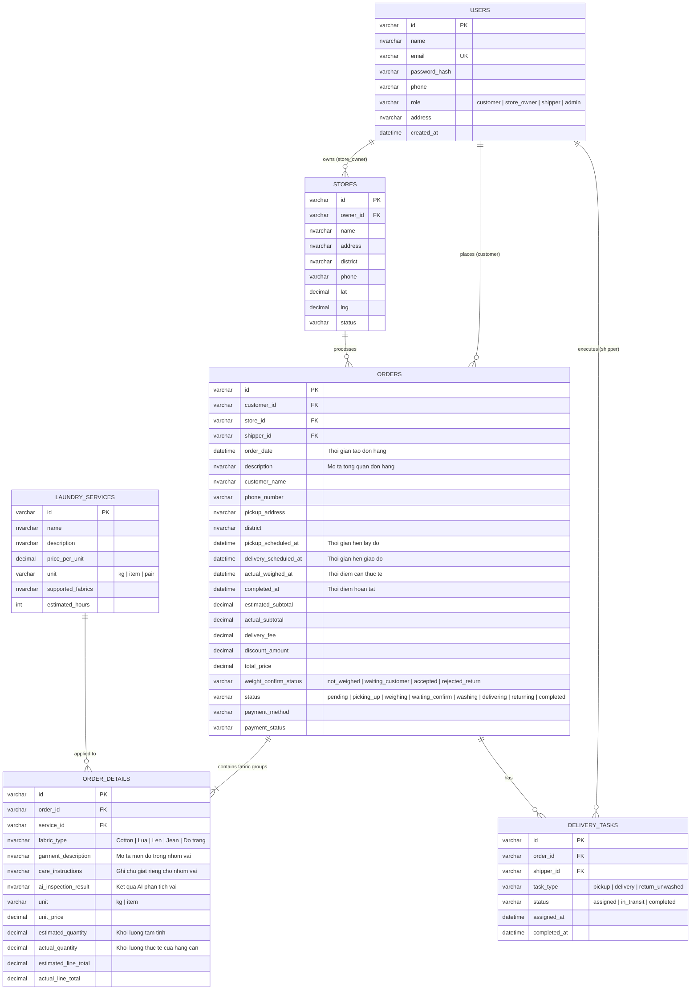
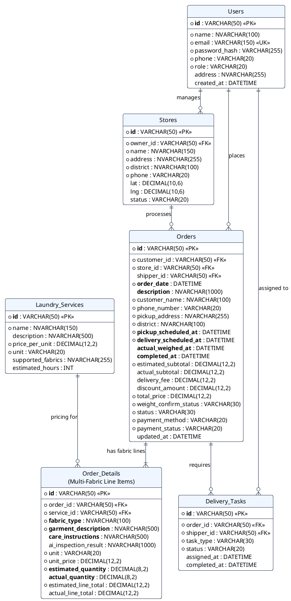

# Thiết kế lại ERD & Cơ sở dữ liệu: Hệ thống Đặt lịch Giặt Sấy (Multi-Fabric & Weight Confirmation)

Tài liệu này trình bày giải pháp nghiệp vụ, cấu trúc bảng chuẩn hóa (3NF) và mã nguồn vẽ sơ đồ **ERD (dbdiagram.io / Draw.io / PlantUML / Mermaid)** khớp 100% với **Sequence Diagram** đã thiết kế.

---

## 1. Giải pháp bài toán: "1 Khách hàng có nhiều loại vải quần áo trong 1 Đơn hàng"

### 1.1. Vấn đề thực tế của khách hàng
Khi khách hàng gửi một giỏ đồ giặt, bên trong thường **lẫn lộn nhiều chất liệu vải khác nhau**:
- **Nhóm 1 (Đồ mặc hàng ngày - Cotton/Polyester):** Có thể giặt sấy chung tính theo kg (VD: 4.5 kg).
- **Nhóm 2 (Đồ nhạy cảm - Áo sơ mi Lụa, Váy Voan, Áo Vest):** Không thể bỏ chung vào máy sấy nhiệt độ cao vì sẽ co rút hoặc hỏng phom, bắt buộc phải tách sang gói **Giặt hấp / Giặt khô (Dry Cleaning)** tính theo chiếc.
- **Nhóm 3 (Chăn mền / Đồ Jean dày / Đồ trắng):** Cần giặt riêng hoặc dùng chế độ giặt nước nóng, không giặt chung với đồ màu để tránh lem màu.

### 1.2. Cách giải quyết thuận tiện nhất cho Khách hàng & Cửa hàng
Thay vì bắt khách hàng phải tạo nhiều đơn hàng riêng lẻ (tốn nhiều lần phí ship và mất công nhập địa chỉ lại), hệ thống giải quyết theo mô hình **1 Đơn hàng (`Orders`) — Nhiều dòng Chi tiết theo Nhóm vải & Gói giặt (`Order_Details`)**:

1. **Lúc khách đặt đơn trên Web (Trải nghiệm thuận tiện nhất):**
   - Khách có thể dùng tính năng **AI Fabric Inspection** (chụp 1 ảnh giỏ đồ hoặc các món đồ đặc biệt), AI tự động phát hiện và gợi ý tách nhóm (VD: *"Phát hiện 1 Áo Lụa & 1 Áo Len -> Đề xuất tách riêng sang gói Giặt hấp, còn lại 4kg đồ thường đưa vào Giặt sấy tiêu chuẩn"*).
   - Hoặc khách bấm **"+ Thêm nhóm quần áo / loại vải"** ngay trong cùng 1 giỏ hàng:
     - **Dòng 1:** Gói *Giặt sấy tiêu chuẩn* — Loại vải: `Cotton / Đồ hỗn hợp mặc hàng ngày` — Tạm tính: `4.0 kg` — Ghi chú dòng: *"Sấy khô vừa, gấp gọn"*.
     - **Dòng 2:** Gói *Giặt hấp cao cấp* — Loại vải: `Lụa (Silk) / Áo dài` — Tạm tính: `2 cái` — Ghi chú dòng: *"Không vắt mạnh, treo móc"*.
     - **Dòng 3:** Gói *Giặt tẩy trắng riêng* — Loại vải: `Áo sơ mi trắng Cotton` — Tạm tính: `1.5 kg` — Ghi chú dòng: *"Giặt riêng tránh lem màu"*.
2. **Lúc Shipper thu gom & Cửa hàng cân đo lại (Khớp Sequence Diagram):**
   - Cửa hàng nhận túi đồ, phân loại thực tế và cân lại **từng dòng `Order_Details`**:
     - Dòng 1 (`estimated_quantity = 4.0 kg` $\rightarrow$ `actual_quantity = 4.8 kg`).
     - Dòng 2 (`estimated_quantity = 2 cái` $\rightarrow$ `actual_quantity = 2 cái`).
   - Hệ thống tự động tính lại `subtotal` của từng dòng và tổng `total_price` của đơn hàng, gửi thông báo cho khách xác nhận **Chấp nhận** hoặc **Từ chối (Trả đồ)** trước khi giặt.

---

## 2. Đặc tả Chi tiết các Bảng trong ERD (Database Schema)

### 2.1. Bảng `Users` (Người dùng: Khách hàng, Chủ cửa hàng, Shipper, Admin)
| Tên trường | Kiểu dữ liệu | Ràng buộc | Mô tả |
| :--- | :--- | :--- | :--- |
| `id` | `VARCHAR(50)` | **PK** | Mã định danh người dùng (UUID) |
| `name` | `NVARCHAR(100)` | NOT NULL | Họ và tên người dùng |
| `email` | `VARCHAR(150)` | UNIQUE, NOT NULL | Email đăng nhập |
| `password_hash` | `VARCHAR(255)` | NOT NULL | Mật khẩu đã mã hóa |
| `phone` | `VARCHAR(20)` | NOT NULL | Số điện thoại liên hệ |
| `role` | `VARCHAR(20)` | NOT NULL | Vai trò: `customer`, `store_owner`, `shipper`, `admin` |
| `address` | `NVARCHAR(255)` | NULL | Địa chỉ mặc định |
| `created_at` | `DATETIME` | DEFAULT NOW() | Thời gian tạo tài khoản |

### 2.2. Bảng `Stores` (Cửa hàng giặt sấy)
| Tên trường | Kiểu dữ liệu | Ràng buộc | Mô tả |
| :--- | :--- | :--- | :--- |
| `id` | `VARCHAR(50)` | **PK** | Mã cửa hàng (VD: `store-hcm-q1`) |
| `owner_id` | `VARCHAR(50)` | **FK** $\rightarrow$ `Users(id)` | Chủ sở hữu / quản lý cửa hàng |
| `name` | `NVARCHAR(150)` | NOT NULL | Tên cửa hàng |
| `address` | `NVARCHAR(255)` | NOT NULL | Địa chỉ cửa hàng |
| `district` | `NVARCHAR(100)` | NOT NULL | Quận/Huyện phục vụ |
| `phone` | `VARCHAR(20)` | NOT NULL | Hotline cửa hàng |
| `lat` / `lng` | `DECIMAL(10,6)` | NULL | Tọa độ bản đồ để tính khoảng cách Shipper |
| `status` | `VARCHAR(20)` | DEFAULT `'active'` | Trạng thái hoạt động (`active`, `closed`) |

### 2.3. Bảng `Laundry_Services` (Danh mục gói dịch vụ giặt)
| Tên trường | Kiểu dữ liệu | Ràng buộc | Mô tả |
| :--- | :--- | :--- | :--- |
| `id` | `VARCHAR(50)` | **PK** | Mã dịch vụ (VD: `wash-dry`, `dry-clean`) |
| `name` | `NVARCHAR(150)` | NOT NULL | Tên dịch vụ (Giặt sấy theo kg, Giặt hấp đồ hiệu...) |
| `description` | `NVARCHAR(500)` | NULL | Mô tả quy trình giặt |
| `price_per_unit` | `DECIMAL(12,2)` | NOT NULL | Đơn giá (VNĐ) |
| `unit` | `VARCHAR(20)` | NOT NULL | Đơn vị tính (`kg`, `item`, `pair`, `set`) |
| `supported_fabrics` | `NVARCHAR(255)` | NULL | Các loại vải phù hợp (Cotton, Lụa, Len, Da...) |
| `estimated_hours` | `INT` | DEFAULT 24 | Thời gian xử lý tiêu chuẩn (giờ) |

### 2.4. Bảng `Orders` (Đơn hàng giặt sấy — Đã bổ sung đầy đủ Thời gian & Description)
| Tên trường | Kiểu dữ liệu | Ràng buộc | Mô tả |
| :--- | :--- | :--- | :--- |
| `id` | `VARCHAR(50)` | **PK** | Mã đơn hàng (VD: `ORD-20261021-001`) |
| `customer_id` | `VARCHAR(50)` | **FK** $\rightarrow$ `Users(id)` | Khách hàng đặt đơn |
| `store_id` | `VARCHAR(50)` | **FK** $\rightarrow$ `Stores(id)` | Cửa hàng tiếp nhận xử lý |
| `shipper_id` | `VARCHAR(50)` | **FK** $\rightarrow$ `Users(id)`, NULL | Shipper nhận giao/nhận đơn |
| `order_date` | `DATETIME` | NOT NULL, DEFAULT NOW() | **Thời gian tạo đơn hàng** |
| `description` | `NVARCHAR(1000)` | NULL | **Mô tả tổng quan đơn hàng & dặn dò chung của khách** (VD: *"Gồm 1 túi đồ mặc ở nhà và 2 áo lụa treo riêng, giao buổi tối"*) |
| `customer_name` | `NVARCHAR(100)` | NOT NULL | Tên người nhận/gửi đồ |
| `phone_number` | `VARCHAR(20)` | NOT NULL | SĐT liên hệ khi lấy/giao đồ |
| `pickup_address` | `NVARCHAR(255)` | NOT NULL | Địa chỉ lấy đồ & giao đồ |
| `district` | `NVARCHAR(100)` | NOT NULL | Quận/Huyện |
| `pickup_scheduled_at` | `DATETIME` | NOT NULL | **Thời gian hẹn lấy đồ** (Ngày + Khung giờ lấy) |
| `delivery_scheduled_at` | `DATETIME` | NOT NULL | **Thời gian hẹn trả đồ dự kiến** |
| `actual_weighed_at` | `DATETIME` | NULL | **Thời gian cửa hàng cân thực tế và báo lại giá** |
| `completed_at` | `DATETIME` | NULL | **Thời gian hoàn tất giao trả đồ cho khách** |
| `estimated_subtotal` | `DECIMAL(12,2)` | NOT NULL | Tổng tiền hàng tạm tính ban đầu |
| `actual_subtotal` | `DECIMAL(12,2)` | NULL | Tổng tiền hàng thực tế sau khi cửa hàng cân lại |
| `delivery_fee` | `DECIMAL(12,2)` | DEFAULT 0 | Phí vận chuyển (1 hoặc 2 chiều nếu hoàn trả) |
| `discount_amount` | `DECIMAL(12,2)` | DEFAULT 0 | Số tiền giảm giá (`promo_code`) |
| `total_price` | `DECIMAL(12,2)` | NOT NULL | Tổng thanh toán cuối cùng |
| `weight_confirm_status`| `VARCHAR(30)` | DEFAULT `'not_weighed'` | Trạng thái xác nhận cân nặng: `not_weighed`, `waiting_customer`, `accepted`, `rejected_return` |
| `status` | `VARCHAR(30)` | DEFAULT `'pending'` | Trạng thái đơn: `pending`, `picking_up`, `weighing`, `waiting_confirm`, `washing`, `ready`, `delivering`, `returning`, `completed`, `cancelled` |
| `payment_method` | `VARCHAR(20)` | NOT NULL | `vietqr`, `vnpay`, `momo`, `cod` |
| `payment_status` | `VARCHAR(20)` | DEFAULT `'pending'` | `pending`, `paid`, `refunded` |
| `updated_at` | `DATETIME` | DEFAULT NOW() | Thời gian cập nhật trạng thái gần nhất |

### 2.5. Bảng `Order_Details` (Chi tiết đơn hàng theo từng Nhóm vải & Gói giặt)
Đây là bảng cốt lõi giải quyết việc **1 đơn hàng có nhiều loại vải quần áo khác nhau**:

| Tên trường | Kiểu dữ liệu | Ràng buộc | Mô tả |
| :--- | :--- | :--- | :--- |
| `id` | `VARCHAR(50)` | **PK** | Mã dòng chi tiết đơn hàng |
| `order_id` | `VARCHAR(50)` | **FK** $\rightarrow$ `Orders(id)` | Thuộc đơn hàng nào |
| `service_id` | `VARCHAR(50)` | **FK** $\rightarrow$ `Laundry_Services(id)` | Gói dịch vụ áp dụng cho nhóm vải này (VD: Giặt sấy thường vs Giặt hấp) |
| `fabric_type` | `NVARCHAR(100)` | NOT NULL | **Loại vải / Chất liệu** (VD: `Cotton`, `Silk/Lụa`, `Wool/Len`, `Denim/Jean`, `Đồ trắng`) |
| `garment_description` | `NVARCHAR(500)` | NOT NULL | **Mô tả chi tiết món đồ trong nhóm vải này** (VD: *"10 áo thun + 5 quần đùi cotton"* hoặc *"2 áo dài lụa tơ tằm màu kem"*) |
| `care_instructions` | `NVARCHAR(500)` | NULL | **Yêu cầu giặt riêng cho loại vải này** (VD: *"Sấy nhiệt thấp dưới 40 độ, không dùng nước xả mùi nồng"*) |
| `ai_inspection_result` | `NVARCHAR(1000)` | NULL | Kết quả AI phân tích vải & cảnh báo vết bẩn (JSON/Text) kèm link ảnh chụp |
| `unit` | `VARCHAR(20)` | NOT NULL | Đơn vị tính (`kg` hoặc `item`) |
| `unit_price` | `DECIMAL(12,2)` | NOT NULL | Đơn giá tại thời điểm đặt |
| `estimated_quantity` | `DECIMAL(8,2)` | NOT NULL | **Khối lượng / Số lượng khách tạm tính** khi đặt đơn (VD: `3.5 kg`) |
| `actual_quantity` | `DECIMAL(8,2)` | NULL | **Khối lượng / Số lượng thực tế cửa hàng cân lại** (VD: `4.2 kg`) |
| `estimated_line_total` | `DECIMAL(12,2)` | NOT NULL | Thành tiền tạm tính (`estimated_quantity * unit_price`) |
| `actual_line_total` | `DECIMAL(12,2)` | NULL | Thành tiền thực tế sau khi cân (`actual_quantity * unit_price`) |

### 2.6. Bảng `Delivery_Tasks` (Lịch trình Shipper lấy đồ / giao đồ / hoàn trả đồ)
| Tên trường | Kiểu dữ liệu | Ràng buộc | Mô tả |
| :--- | :--- | :--- | :--- |
| `id` | `VARCHAR(50)` | **PK** | Mã chuyến giao nhận |
| `order_id` | `VARCHAR(50)` | **FK** $\rightarrow$ `Orders(id)` | Đơn hàng liên kết |
| `shipper_id` | `VARCHAR(50)` | **FK** $\rightarrow$ `Users(id)` | Shipper thực hiện |
| `task_type` | `VARCHAR(30)` | NOT NULL | Loại nhiệm vụ: `pickup` (Lấy đồ về tiệm), `delivery` (Giao đồ sạch), `return_unwashed` (Hoàn trả đồ khi khách từ chối giá mới) |
| `status` | `VARCHAR(20)` | DEFAULT `'assigned'` | `assigned`, `in_transit`, `completed` |
| `assigned_at` | `DATETIME` | DEFAULT NOW() | Thời điểm nhận chuyến |
| `completed_at` | `DATETIME` | NULL | Thời điểm hoàn thành chuyến |

---

## 3. Code vẽ ERD (Dùng cho dbdiagram.io, Draw.io, Mermaid & PlantUML)

### 3.1. Code DBML (Dán trực tiếp vào https://dbdiagram.io hoặc Import vào Draw.io)
> **Mẹo dùng trong Draw.io:** Mở `app.diagrams.net` $\rightarrow$ Chọn **Arrange** $\rightarrow$ **Insert** $\rightarrow$ **Advanced** $\rightarrow$ **SQL / DBML** (hoặc dán vào dbdiagram.io để xuất hình ảnh PNG/PDF sắc nét cho báo cáo).

```dbml
Table Users {
  id varchar(50) [pk]
  name nvarchar(100) [not null]
  email varchar(150) [unique, not null]
  password_hash varchar(255) [not null]
  phone varchar(20) [not null]
  role varchar(20) [not null, note: 'customer, store_owner, shipper, admin']
  address nvarchar(255)
  created_at datetime [default: `now()`]
}

Table Stores {
  id varchar(50) [pk]
  owner_id varchar(50) [ref: > Users.id]
  name nvarchar(150) [not null]
  address nvarchar(255) [not null]
  district nvarchar(100) [not null]
  phone varchar(20) [not null]
  lat decimal(10,6)
  lng decimal(10,6)
  status varchar(20) [default: 'active']
}

Table Laundry_Services {
  id varchar(50) [pk]
  name nvarchar(150) [not null]
  description nvarchar(500)
  price_per_unit decimal(12,2) [not null]
  unit varchar(20) [not null, note: 'kg, item, pair, set']
  supported_fabrics nvarchar(255) [note: 'Cotton, Silk, Wool, Denim...']
  estimated_hours int [default: 24]
}

Table Orders {
  id varchar(50) [pk]
  customer_id varchar(50) [not null, ref: > Users.id]
  store_id varchar(50) [not null, ref: > Stores.id]
  shipper_id varchar(50) [ref: > Users.id]
  order_date datetime [not null, default: `now()`, note: 'Thời gian tạo đơn hàng']
  description nvarchar(1000) [note: 'Mô tả tổng quan đơn hàng & ghi chú chung']
  customer_name nvarchar(100) [not null]
  phone_number varchar(20) [not null]
  pickup_address nvarchar(255) [not null]
  district nvarchar(100) [not null]
  pickup_scheduled_at datetime [not null, note: 'Thời gian hẹn lấy đồ']
  delivery_scheduled_at datetime [not null, note: 'Thời gian hẹn giao đồ']
  actual_weighed_at datetime [note: 'Thời điểm cửa hàng cân lại đồ']
  completed_at datetime [note: 'Thời điểm hoàn tất đơn hàng']
  estimated_subtotal decimal(12,2) [not null]
  actual_subtotal decimal(12,2)
  delivery_fee decimal(12,2) [default: 0]
  discount_amount decimal(12,2) [default: 0]
  total_price decimal(12,2) [not null]
  weight_confirm_status varchar(30) [default: 'not_weighed', note: 'not_weighed, waiting_customer, accepted, rejected_return']
  status varchar(30) [default: 'pending', note: 'pending, picking_up, weighing, waiting_confirm, washing, delivering, returning, completed, cancelled']
  payment_method varchar(20) [not null]
  payment_status varchar(20) [default: 'pending']
  updated_at datetime [default: `now()`]
}

Table Order_Details {
  id varchar(50) [pk]
  order_id varchar(50) [not null, ref: > Orders.id]
  service_id varchar(50) [not null, ref: > Laundry_Services.id]
  fabric_type nvarchar(100) [not null, note: 'Cotton, Lụa (Silk), Len (Wool), Đồ trắng, Jean...']
  garment_description nvarchar(500) [not null, note: 'Mô tả các món đồ thuộc nhóm vải này']
  care_instructions nvarchar(500) [note: 'Hướng dẫn giặt riêng cho loại vải này']
  ai_inspection_result nvarchar(1000) [note: 'Kết quả AI nhận diện chất liệu vải & vết bẩn']
  unit varchar(20) [not null, note: 'kg hoặc item']
  unit_price decimal(12,2) [not null]
  estimated_quantity decimal(8,2) [not null, note: 'Số kg/món khách tạm tính']
  actual_quantity decimal(8,2) [note: 'Số kg/món cửa hàng cân thực tế']
  estimated_line_total decimal(12,2) [not null]
  actual_line_total decimal(12,2)
}

Table Delivery_Tasks {
  id varchar(50) [pk]
  order_id varchar(50) [not null, ref: > Orders.id]
  shipper_id varchar(50) [not null, ref: > Users.id]
  task_type varchar(30) [not null, note: 'pickup, delivery, return_unwashed']
  status varchar(20) [default: 'assigned']
  assigned_at datetime [default: `now()`]
  completed_at datetime
}
```

---

### 3.2. Code Mermaid ERD (Import trực tiếp vào Draw.io: `Arrange -> Insert -> Advanced -> Mermaid`)



---

### 3.3. Code PlantUML ERD (Dành cho PlantUML / Kroki)



---

## 4. Ví dụ Minh họa Dữ liệu Lưu trữ Thực tế (Để đưa vào Báo cáo)

Giả sử khách hàng **Nguyễn Văn A** đặt 1 đơn hàng gồm cả **đồ mặc hàng ngày (Cotton)** và **2 chiếc áo dài Lụa**, dữ liệu được lưu vào 2 bảng `Orders` và `Order_Details` như sau:

### Bảng `Orders` (1 dòng duy nhất cho cả đơn)
- `id`: `"ORD-20261021-01"`
- `order_date`: `"2026-10-21 08:30:00"` *(Thời gian tạo đơn hàng)*
- `description`: `"Giặt đồ gia đình tuần này và 2 áo dài lụa đi tiệc, vui lòng giao sau 18h tối"` *(Description tổng của đơn hàng)*
- `pickup_scheduled_at`: `"2026-10-21 10:00:00"`
- `delivery_scheduled_at`: `"2026-10-22 18:30:00"`
- `estimated_subtotal`: `160,000đ`
- `actual_subtotal`: `175,000đ` *(Sau khi tiệm cân lại thực tế)*
- `weight_confirm_status`: `"accepted"` *(Khách đã bấm đồng ý giá mới)*

### Bảng `Order_Details` (Tách thành 2 dòng theo Loại vải & Gói giặt)
| `id` | `order_id` | `service_id` | `fabric_type` | `garment_description` | `care_instructions` | `estimated_quantity` | `actual_quantity` | `unit_price` | `actual_line_total` |
| :--- | :--- | :--- | :--- | :--- | :--- | :--- | :--- | :--- | :--- |
| `OD-01` | `ORD-20261021-01` | `wash-dry` (Giặt sấy kg) | **Cotton / Đồ hỗn hợp** | 12 áo thun, 6 quần short mặc nhà | Sấy khô vừa, gấp gọn | `4.0 kg` | `5.0 kg` | `15,000đ/kg` | `75,000đ` |
| `OD-02` | `ORD-20261021-01` | `dry-clean` (Giặt hấp) | **Lụa tơ tằm (Silk)** | 2 áo dài lụa màu vàng kem | Giặt khô, không vắt xoắn, treo móc | `2 cái` | `2 cái` | `50,000đ/cái` | `100,000đ` |

---

## 5. Kế hoạch thực hiện tiếp theo (Nếu bạn bấm Proceed)
Nếu bạn muốn lưu bộ tài liệu ERD & Database Specification này thành file chính thức trong thư mục dự án (ví dụ `docs/ERD_AND_DATABASE_SPEC.md`) hoặc đồng bộ thêm các trường này vào Model `LaundryOrder.ts` của hệ thống, hãy bấm **Proceed** (hoặc phản hồi yêu cầu chỉnh sửa thêm).
