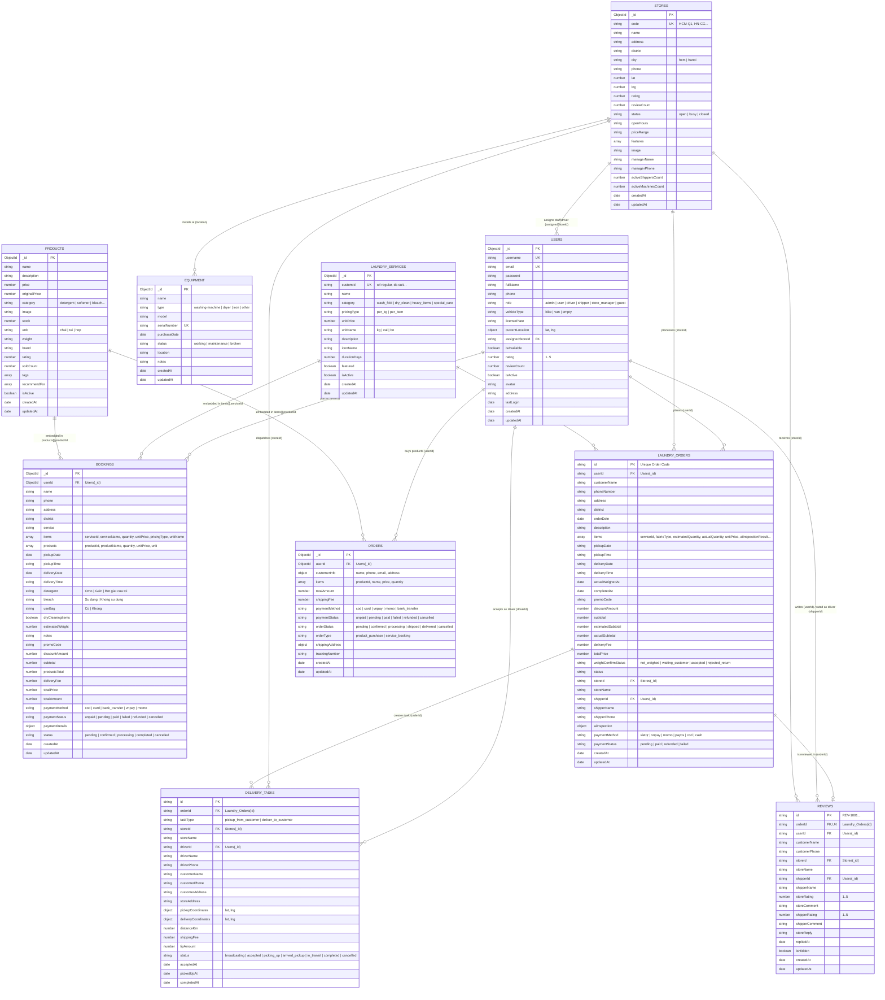
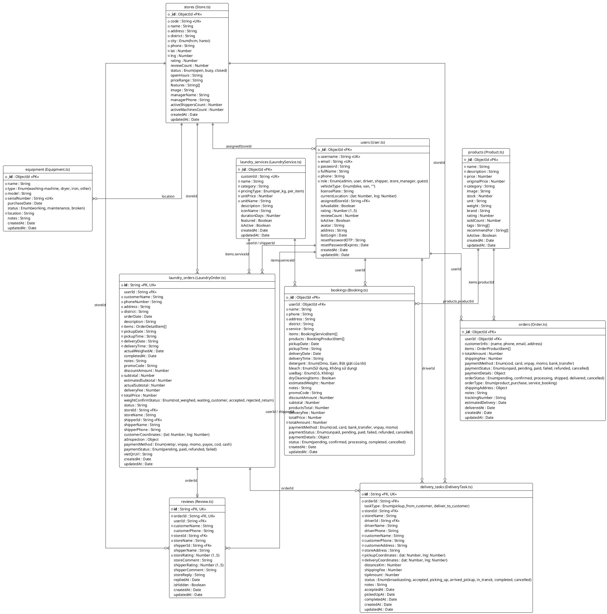

# Đặc tả Cơ sở dữ liệu & Sơ đồ ERD theo đúng Mã nguồn Dự án (`src/server/models`)

Tài liệu này mô tả chính xác **10 Bảng (Collections/Models)** đang được cài đặt thực tế trong mã nguồn dự án (`src/server/models/*.ts`, sử dụng **MongoDB & Mongoose**):
1. **`users`** (`User.ts`): Quản lý tài khoản Khách hàng, Admin, Chủ cửa hàng (`store_manager`) và Tài xế (`driver`/`shipper`).
2. **`stores`** (`Store.ts`): Quản lý danh sách chi nhánh cửa hàng giặt sấy và tọa độ bản đồ Leaflet.
3. **`laundry_services`** (`LaundryService.ts`): Danh mục các gói dịch vụ giặt sấy, giặt khô, giặt đồ nặng.
4. **`products`** (`Product.ts`): Danh mục sản phẩm phụ trợ bán kèm (nước giặt, nước xả, túi giặt...).
5. **`bookings`** (`Booking.ts`): Đơn đặt lịch giặt là & mua kèm sản phẩm từ giao diện Đặt lịch (`/booking`).
6. **`laundry_orders`** (`LaundryOrder.ts`): Đơn giặt thông minh mở rộng (hỗ trợ nhiều dòng vải `items`, cân thực tế `actualQuantity`, AI kiểm tra vải `aiInspection` và thanh toán VietQR/PayOS).
7. **`delivery_tasks`** (`DeliveryTask.ts`): Nhiệm vụ điều phối chuyến lấy đồ / giao đồ cho Tài xế (`driver`).
8. **`orders`** (`Order.ts`): Đơn hàng thương mại điện tử mua lẻ sản phẩm chăm sóc vải.
9. **`equipment`** (`Equipment.ts`): Quản lý trang thiết bị máy giặt, máy sấy, bàn ủi tại cửa hàng.
10. **`reviews`** (`Review.ts`): Lưu trữ đánh giá chất lượng cửa hàng (`storeRating`, `storeComment`), đánh giá tài xế giao nhận (`shipperRating`, `shipperComment`), phản hồi của chủ tiệm (`storeReply`) và trạng thái kiểm duyệt của Admin (`isHidden`).

---

## 1. Sơ đồ ERD Tổng thể theo đúng Dự án

### 1.1. Code Mermaid ERD (Dán vào Draw.io: `Arrange -> Insert -> Advanced -> Mermaid`)

### 1.2. Code PlantUML ERD (Dán vào Draw.io: `Arrange -> Insert -> Advanced -> PlantUML`)

---

## 2. Đặc tả Chi tiết Từng Bảng theo đúng Code Dự án

### 2.1. Bảng `users` (`src/server/models/User.ts`)
Lưu thông tin tài khoản người dùng toàn hệ thống (Khách hàng, Quản trị viên, Chủ tiệm, Tài xế).

| Tên trường (Field) | Kiểu dữ liệu (Mongoose) | Ràng buộc / Mặc định | Mô tả chi tiết |
| :--- | :--- | :--- | :--- |
| `_id` | `ObjectId / String` | **PK**, Auto | Mã định danh duy nhất của tài khoản |
| `username` | `String` | **NOT NULL, UNIQUE**, `minlength: 3` | Tên đăng nhập |
| `email` | `String` | **NOT NULL, UNIQUE**, Lowercase | Địa chỉ email |
| `password` | `String` | **NOT NULL**, `minlength: 6` | Mật khẩu đã mã hóa bằng `bcryptjs` |
| `fullName` | `String` | **NOT NULL**, Trim | Họ và tên đầy đủ |
| `phone` | `String` | **NOT NULL**, Regex `10-11` số | Số điện thoại liên hệ |
| `role` | `String` | ENUM: `'admin'`, `'user'`, `'driver'`, `'shipper'`, `'store_manager'`, `'guest'` (Default: `'user'`) | Phân quyền vai trò người dùng |
| `vehicleType` | `String` | ENUM: `'bike'`, `'van'`, `''` (Default: `''`) | Loại xe giao nhận (dành cho tài xế) |
| `licensePlate` | `String` | Default: `''` | Biển số xe (dành cho tài xế) |
| `currentLocation` | `Object { lat: Number, lng: Number }` | Optional | Tọa độ GPS hiện tại của tài xế |
| `assignedStoreId` | `String` | **FK** $\rightarrow$ `stores`, Default: `''` | Mã cửa hàng được gán (dành cho chủ tiệm / tài xế) |
| `isAvailable` | `Boolean` | Default: `true` | Trạng thái rảnh/bận nhận chuyến của tài xế |
| `rating` | `Number` | Default: `5.0`, Min: `1`, Max: `5` | Điểm đánh giá trung bình của tài xế (`shipper`/`driver`) |
| `reviewCount` | `Number` | Default: `0` | Tổng số lượt khách hàng đánh giá tài xế |
| `isActive` | `Boolean` | Default: `true` | Trạng thái kích hoạt tài khoản |
| `avatar` | `String` | Default: `''` | Đường dẫn ảnh đại diện |
| `address` | `String` | Default: `''` | Địa chỉ mặc định của khách hàng |
| `lastLogin` | `Date` | Optional | Thời gian đăng nhập lần cuối |
| `resetPasswordOTP` | `String` | Optional | Mã OTP khôi phục mật khẩu |
| `resetPasswordExpires`| `Date` | Optional | Thời hạn hết hạn của OTP |
| `createdAt`, `updatedAt`| `Date` | Auto (`timestamps: true`) | Thời điểm tạo và cập nhật bản ghi |

---

### 2.2. Bảng `stores` (`src/server/models/Store.ts`)
Lưu thông tin các chi nhánh tiệm giặt, trạng thái vận hành và tọa độ hiển thị trên bản đồ.

| Tên trường (Field) | Kiểu dữ liệu (Mongoose) | Ràng buộc / Mặc định | Mô tả chi tiết |
| :--- | :--- | :--- | :--- |
| `_id` | `ObjectId / String` | **PK**, Auto | Mã định danh cửa hàng |
| `code` | `String` | **NOT NULL, UNIQUE**, Uppercase | Mã chi nhánh (VD: `HCM-Q1`, `HN-CG`) |
| `name` | `String` | **NOT NULL**, Trim | Tên cửa hàng giặt sấy |
| `address` | `String` | **NOT NULL**, Trim | Địa chỉ chi tiết của tiệm |
| `district` | `String` | **NOT NULL** | Quận / Huyện |
| `city` | `String` | ENUM: `'hcm'`, `'hanoi'` (Default: `'hcm'`) | Thành phố hoạt động |
| `phone` | `String` | **NOT NULL** | Số điện thoại hotline cửa hàng |
| `lat` | `Number` | **NOT NULL** | Vĩ độ trên bản đồ (Latitude) |
| `lng` | `Number` | **NOT NULL** | Kinh độ trên bản đồ (Longitude) |
| `rating` | `Number` | Default: `4.8` | Điểm đánh giá trung bình |
| `reviewCount` | `Number` | Default: `100` | Tổng số lượt đánh giá |
| `status` | `String` | ENUM: `'open'`, `'busy'`, `'closed'` (Default: `'open'`) | Trạng thái cửa hàng (Mở cửa / Quá tải / Đóng cửa) |
| `openHours` | `String` | Default: `'06:00 - 22:00'` | Giờ mở cửa phục vụ |
| `priceRange` | `String` | Default: `'15.000đ - 120.000đ'` | Khoảng giá tham khảo |
| `features` | `Array<String>` | Optional | Danh sách tiện ích của tiệm |
| `image` | `String` | Default URL | Ảnh minh họa cửa hàng |
| `managerName` | `String` | Optional | Họ tên cửa hàng trưởng / chủ tiệm |
| `managerPhone` | `String` | Optional | Số điện thoại cửa hàng trưởng |
| `activeShippersCount` | `Number` | Default: `8` | Số lượng shipper đang trực tại chi nhánh |
| `activeMachinesCount` | `Number` | Default: `16` | Số lượng máy giặt/sấy hoạt động tại tiệm |
| `createdAt`, `updatedAt`| `Date` | Auto (`timestamps: true`) | Thời điểm tạo và cập nhật |

---

### 2.3. Bảng `laundry_services` (`src/server/models/LaundryService.ts`)
Danh mục các gói dịch vụ giặt sấy, giặt khô, giặt đồ nặng.

| Tên trường (Field) | Kiểu dữ liệu (Mongoose) | Ràng buộc / Mặc định | Mô tả chi tiết |
| :--- | :--- | :--- | :--- |
| `_id` | `ObjectId / String` | **PK**, Auto | Mã ObjectId của dịch vụ |
| `customId` | `String` | Default: `null` | Mã định danh tĩnh phía Client (VD: `'wf-regular'`, `'dc-suit'`) |
| `name` | `String` | **NOT NULL**, Trim | Tên gói dịch vụ giặt là |
| `category` | `String` | **NOT NULL** | Nhóm dịch vụ (`'wash_fold'`, `'dry_clean'`, `'heavy_items'`, `'special_care'`) |
| `pricingType` | `String` | **NOT NULL** | Kiểu tính giá (`'per_kg'` hoặc `'per_item'`) |
| `unitPrice` | `Number` | **NOT NULL**, `min: 0` | Đơn giá trên 1 đơn vị tính (VNĐ) |
| `unitName` | `String` | **NOT NULL** | Đơn vị tính (`'kg'`, `'cái'`, `'bộ'`, `'đôi'`) |
| `description` | `String` | Default: `''` | Mô tả quy trình xử lý của gói giặt |
| `iconName` | `String` | Default: `'Shirt'` | Tên icon hiển thị (`Lucide Icon`) |
| `durationDays` | `Number` | Default: `1` | Thời gian xử lý tiêu chuẩn (số ngày) |
| `featured` | `Boolean` | Default: `false` | Đánh dấu dịch vụ nổi bật |
| `isActive` | `Boolean` | Default: `true` | Trạng thái hiển thị dịch vụ |
| `createdAt`, `updatedAt`| `Date` | Auto (`timestamps: true`) | Thời điểm tạo và cập nhật |

---

### 2.4. Bảng `products` (`src/server/models/Product.ts`)
Danh mục hóa mỹ phẩm và phụ kiện giặt là bán kèm (nước giặt hữu cơ, nước xả vải, túi giặt...).

| Tên trường (Field) | Kiểu dữ liệu (Mongoose) | Ràng buộc / Mặc định | Mô tả chi tiết |
| :--- | :--- | :--- | :--- |
| `_id` | `ObjectId / String` | **PK**, Auto | Mã sản phẩm |
| `name` | `String` | **NOT NULL**, Trim | Tên sản phẩm |
| `description` | `String` | **NOT NULL** | Mô tả công dụng sản phẩm |
| `price` | `Number` | **NOT NULL**, `min: 0` | Giá bán hiện tại (VNĐ) |
| `originalPrice` | `Number` | Default: `null` | Giá niêm yết gốc (trước giảm giá) |
| `category` | `String` | **NOT NULL**, Indexed | Danh mục (`'detergent'`, `'softener'`, `'bleach'`, `'accessory'`) |
| `image` | `String` | Default: `''` | Ảnh sản phẩm |
| `stock` | `Number` | Default: `0`, `min: 0` | Số lượng tồn kho |
| `unit` | `String` | Default: `'chai'` | Đơn vị tính (`'chai'`, `'túi'`, `'hộp'`) |
| `weight` | `String` | Default: `''` | Dung tích / Khối lượng tịnh |
| `brand` | `String` | Default: `''` | Thương hiệu sản phẩm |
| `rating` | `Number` | Default: `5` (`0 - 5`) | Điểm đánh giá |
| `soldCount` | `Number` | Default: `0` | Số lượng đã bán |
| `tags` | `Array<String>` | Indexed | Nhãn phân loại tìm kiếm |
| `recommendFor` | `Array<String>` | Default: `['all']` | Gợi ý bán chéo theo loại dịch vụ giặt |
| `isActive` | `Boolean` | Default: `true`, Indexed | Trạng thái đang kinh doanh |
| `createdAt`, `updatedAt`| `Date` | Auto (`timestamps: true`) | Thời điểm tạo và cập nhật |

---

### 2.5. Bảng `bookings` (`src/server/models/Booking.ts`)
Bảng lưu đơn đặt lịch giặt là của khách hàng từ luồng Đặt lịch (`/booking`), Tra cứu (`/tracking`) và Quản lý đơn Admin (`/admin/orders`).

| Tên trường (Field) | Kiểu dữ liệu (Mongoose) | Ràng buộc / Mặc định | Mô tả chi tiết |
| :--- | :--- | :--- | :--- |
| `_id` | `ObjectId / String` | **PK**, Auto | Mã đơn đặt lịch |
| `userId` | `ObjectId` | **FK** $\rightarrow$ `users._id`, Indexed | Tài khoản khách đặt (Nullable nếu khách vãng lai) |
| `name` | `String` | **NOT NULL**, Trim | Họ tên khách nhận/giao đồ |
| `phone` | `String` | **NOT NULL**, Indexed | Số điện thoại liên hệ & tra cứu |
| `address` | `String` | **NOT NULL**, Trim | Địa chỉ thu gom và giao trả tận nơi |
| `district` | `String` | Default: `''` | Quận / Huyện |
| `service` | `String` | **NOT NULL** | Chuỗi tóm tắt các dịch vụ trong đơn |
| `items` | `Array<Object>` | Embedded Array | Danh sách gói giặt đã chọn: `{ serviceId, serviceName, quantity, unitPrice, pricingType, unitName }` |
| `products` | `Array<Object>` | Embedded Array | Danh sách sản phẩm mua kèm: `{ productId, productName, quantity, unitPrice, unit }` |
| `pickupDate` | `Date` | Optional | Ngày hẹn tới lấy đồ bẩn |
| `pickupTime` | `String` | Default: `''` | Khung giờ hẹn lấy đồ (VD: `'08:00 - 10:00'`) |
| `deliveryDate` | `Date` | Optional | Ngày hẹn giao trả đồ sạch |
| `deliveryTime` | `String` | Default: `''` | Khung giờ hẹn giao đồ (VD: `'14:00 - 16:00'`) |
| `detergent` | `String` | ENUM: `'Omo'`, `'Gain'`, `'Bột giặt của tôi'` | Tùy chọn loại nước giặt/bột giặt |
| `bleach` | `String` | ENUM: `'Sử dụng'`, `'Không sử dụng'` | Tùy chọn dùng thuốc tẩy trắng |
| `useBag` | `String` | ENUM: `'Có'`, `'Không'` | Tùy chọn dùng túi giặt bảo vệ đồ |
| `dryCleaningItems` | `Boolean` | Default: `false` | Đánh dấu đơn có kèm đồ giặt khô |
| `estimatedWeight` | `Number` | `min: 0` | Tổng khối lượng ước tính (kg) |
| `notes` | `String` | Default: `''` | Ghi chú dặn dò riêng của khách |
| `promoCode` | `String` | Default: `''` | Mã khuyến mãi áp dụng (VD: `GIATMOI15`) |
| `discountAmount` | `Number` | Default: `0` | Số tiền giảm giá (VNĐ) |
| `subtotal` | `Number` | Default: `0` | Tạm tính tiền dịch vụ giặt |
| `productsTotal` | `Number` | Default: `0` | Tạm tính tiền sản phẩm mua kèm |
| `deliveryFee` | `Number` | Default: `0` | Phí giao nhận 2 chiều |
| `totalPrice` | `Number` | Default: `0` | Tổng tiền đơn hàng |
| `totalAmount` | `Number` | **NOT NULL**, Default: `0` | Tổng thanh toán cuối cùng |
| `paymentMethod` | `String` | ENUM: `'cod'`, `'card'`, `'bank_transfer'`, `'vnpay'`, `'momo'` | Phương thức thanh toán |
| `paymentStatus` | `String` | ENUM: `'unpaid'`, `'pending'`, `'paid'`, `'failed'`, `'refunded'`, `'cancelled'` | Trạng thái thanh toán |
| `paymentDetails` | `Object` | `{ transactionId, paymentGateway, amount, currency, paidAt, cardLast4, bankName, gatewayResponse }` | Thông tin giao dịch cổng thanh toán |
| `status` | `String` | ENUM: `'pending'`, `'confirmed'`, `'processing'`, `'completed'`, `'cancelled'` | Trạng thái xử lý đơn giặt |
| `createdAt`, `updatedAt`| `Date` | Auto (`timestamps: true`), Indexed | Thời điểm tạo và cập nhật đơn |

---

### 2.6. Bảng `laundry_orders` & Chi tiết dòng đồ `items` (`src/server/models/LaundryOrder.ts`)
Lưu đơn giặt thông minh hỗ trợ bóc tách từng dòng vải (`OrderDetailItem`), đối chiếu khối lượng tạm tính vs. khối lượng thực tế tại tiệm, và lưu kết quả phân tích AI.

#### A. Cấu trúc bảng chính `laundry_orders`:
| Tên trường (Field) | Kiểu dữ liệu (Mongoose) | Ràng buộc / Mặc định | Mô tả chi tiết |
| :--- | :--- | :--- | :--- |
| `id` | `String` | **PK, UNIQUE, NOT NULL** | Mã đơn giặt (VD: `ORD-2026-...`) |
| `userId` | `String` | **FK** $\rightarrow$ `users._id` | Mã tài khoản khách hàng |
| `customerName` | `String` | **NOT NULL** | Họ tên khách hàng |
| `phoneNumber` | `String` | **NOT NULL** | Số điện thoại khách hàng |
| `address` | `String` | **NOT NULL** | Địa chỉ lấy và trả đồ |
| `district` | `String` | **NOT NULL** | Quận / Huyện |
| `orderDate` | `Date` | Default: `Date.now` | Thời điểm tạo đơn |
| `description` | `String` | Default: `''` | Mô tả chung của đơn hàng |
| `items` | `Array<OrderDetailItem>`| **NOT NULL** | Danh sách chi tiết từng dòng đồ giặt (xem bảng B bên dưới) |
| `pickupDate`, `pickupTime` | `String` | **NOT NULL** | Ngày & Khung giờ hẹn lấy đồ |
| `deliveryDate`, `deliveryTime`| `String` | **NOT NULL** | Ngày & Khung giờ hẹn trả đồ |
| `actualWeighedAt` | `Date` | Default: `null` | Thời điểm cửa hàng cân lại đồ thực tế |
| `completedAt` | `Date` | Default: `null` | Thời điểm hoàn thành đơn hàng |
| `notes` | `String` | Default: `''` | Ghi chú đơn hàng |
| `promoCode` | `String` | Optional | Mã giảm giá |
| `discountAmount` | `Number` | Default: `0` | Số tiền giảm giá |
| `subtotal` | `Number` | **NOT NULL** | Tổng tiền dịch vụ hiện hành |
| `estimatedSubtotal` | `Number` | Optional | Tổng tiền dịch vụ tạm tính ban đầu |
| `actualSubtotal` | `Number` | Default: `null` | Tổng tiền dịch vụ thực tế sau khi tiệm cân |
| `deliveryFee` | `Number` | Default: `0` | Phí vận chuyển |
| `totalPrice` | `Number` | **NOT NULL** | Tổng tiền thanh toán cuối cùng |
| `weightConfirmStatus`| `String` | ENUM: `'not_weighed'`, `'waiting_customer'`, `'accepted'`, `'rejected_return'` | Trạng thái khách xác nhận cân nặng thực tế |
| `status` | `String` | Default: `'pending'` | Trạng thái đơn hàng |
| `storeId` | `String` | **FK** $\rightarrow$ `stores._id` | Mã cửa hàng nhận xử lý |
| `storeName` | `String` | Default: `'Tiệm Giặt Sấy Vô Trùng Q1'` | Tên cửa hàng xử lý |
| `shipperId` | `String` | **FK** $\rightarrow$ `users._id` | Mã tài xế giao nhận |
| `shipperName`, `shipperPhone` | `String` | Default: `''` | Tên và SĐT tài xế |
| `customerCoordinates`| `Object { lat, lng }` | Default HCM coords | Tọa độ địa chỉ khách hàng |
| `aiInspection` | `Object` | Default: `null` | Kết quả phân tích chất liệu/vết bẩn từ AI Gemini |
| `paymentMethod` | `String` | ENUM: `'vietqr'`, `'vnpay'`, `'momo'`, `'payos'`, `'cod'`, `'cash'` | Phương thức thanh toán |
| `paymentStatus` | `String` | ENUM: `'pending'`, `'paid'`, `'refunded'`, `'failed'` | Trạng thái thanh toán |
| `vietQrUrl` | `String` | Default: `''` | Đường dẫn mã QR thanh toán VietQR |
| `createdAt`, `updatedAt`| `Date` | Auto (`timestamps: true`) | Thời điểm tạo và cập nhật |

#### B. Cấu trúc chi tiết dòng đồ giặt `OrderDetailItem` (`laundry_orders.items[]` — Tương ứng bảng `Order_Details`):
| Tên trường (Field) | Kiểu dữ liệu | Ràng buộc / Mặc định | Mô tả chi tiết |
| :--- | :--- | :--- | :--- |
| `serviceId` | `String` | **NOT NULL**, **FK** $\rightarrow$ `laundry_services` | Mã gói dịch vụ giặt |
| `serviceName` | `String` | **NOT NULL** | Tên gói dịch vụ giặt |
| `fabricType` | `String` | Default: `'Cotton / Đồ hỗn hợp'` | Nhóm chất liệu vải (`Cotton`, `Lụa`, `Len`, `Đồ trắng`...) |
| `garmentDescription`| `String` | Default: `''` | Mô tả món đồ cụ thể |
| `careInstructions` | `String` | Default: `''` | Lưu ý giặt ủi đặc biệt |
| `pricingType` | `String` | Default: `'per_kg'` | Cách tính giá (`per_kg` / `per_item`) |
| `unitName` | `String` | Default: `'kg'` | Đơn vị tính (`kg`, `cái`, `bộ`) |
| `unitPrice` | `Number` | **NOT NULL** | Đơn giá áp dụng |
| `quantity` | `Number` | **NOT NULL** | Số lượng/Khối lượng tính tiền hiện hành |
| `estimatedQuantity` | `Number` | Optional | Khối lượng / Số lượng khách tạm tính khi đặt |
| `actualQuantity` | `Number` | Default: `null` | Khối lượng / Số lượng cửa hàng cân thực tế |
| `estimatedLineTotal`| `Number` | Optional | Thành tiền tạm tính của dòng đồ |
| `actualLineTotal` | `Number` | Default: `null` | Thành tiền thực tế sau khi cân của dòng đồ |
| `aiInspectionResult`| `String` | Default: `''` | Ghi chú kết quả AI phân tích ảnh chụp món đồ / tem mác |

---

### 2.7. Bảng `delivery_tasks` (`src/server/models/DeliveryTask.ts`)
Lưu thông tin các chuyến đi lấy đồ bẩn (`pickup_from_customer`) và đi giao đồ sạch (`deliver_to_customer`) dành cho Shipper/Driver.

| Tên trường (Field) | Kiểu dữ liệu (Mongoose) | Ràng buộc / Mặc định | Mô tả chi tiết |
| :--- | :--- | :--- | :--- |
| `id` | `String` | **PK, UNIQUE, NOT NULL** | Mã nhiệm vụ giao nhận |
| `orderId` | `String` | **NOT NULL, FK** $\rightarrow$ `laundry_orders.id` | Mã đơn giặt liên kết |
| `taskType` | `String` | ENUM: `'pickup_from_customer'`, `'deliver_to_customer'` | Loại nhiệm vụ (Lấy đồ từ khách / Giao đồ sạch cho khách) |
| `storeId` | `String` | **NOT NULL, FK** $\rightarrow$ `stores._id` | Mã cửa hàng giặt |
| `storeName`, `storeAddress` | `String` | **NOT NULL** | Tên và địa chỉ cửa hàng |
| `driverId` | `String` | **FK** $\rightarrow$ `users._id`, Default: `''` | Mã tài xế nhận chuyến |
| `driverName`, `driverPhone` | `String` | Default: `''` | Họ tên và SĐT tài xế |
| `customerName`, `customerPhone`, `customerAddress` | `String` | **NOT NULL** | Thông tin liên hệ và địa chỉ khách hàng |
| `pickupCoordinates` | `Object { lat: Number, lng: Number }` | **NOT NULL** | Tọa độ điểm lấy hàng |
| `deliveryCoordinates`| `Object { lat: Number, lng: Number }` | **NOT NULL** | Tọa độ điểm giao hàng |
| `distanceKm` | `Number` | Default: `2.5` | Khoảng cách quãng đường (km) |
| `shippingFee` | `Number` | Default: `20000` | Phí vận chuyển của chuyến |
| `tipAmount` | `Number` | Default: `0` | Tiền tip thêm cho tài xế |
| `status` | `String` | ENUM: `'broadcasting'`, `'accepted'`, `'picking_up'`, `'arrived_pickup'`, `'in_transit'`, `'completed'`, `'cancelled'` | Trạng thái chuyến giao nhận |
| `notes` | `String` | Default: `''` | Ghi chú giao nhận |
| `acceptedAt`, `pickedUpAt`, `completedAt` | `Date` | Optional | Mốc thời gian nhận chuyến, lấy hàng và hoàn thành |
| `createdAt`, `updatedAt`| `Date` | Auto (`timestamps: true`) | Thời điểm tạo và cập nhật |

---

### 2.8. Bảng `orders` (`src/server/models/Order.ts`)
Lưu đơn đặt mua lẻ các sản phẩm chăm sóc vải (`Product`).

| Tên trường (Field) | Kiểu dữ liệu (Mongoose) | Ràng buộc / Mặc định | Mô tả chi tiết |
| :--- | :--- | :--- | :--- |
| `_id` | `ObjectId / String` | **PK**, Auto | Mã đơn hàng sản phẩm |
| `userId` | `ObjectId` | **FK** $\rightarrow$ `users._id`, Indexed | Người dùng đặt mua |
| `customerInfo` | `Object` | `{ name, phone, email, address }` | Thông tin người nhận hàng |
| `items` | `Array<Object>` | `[{ productId -> products._id, name, price, quantity }]` | Danh sách sản phẩm đặt mua |
| `totalAmount` | `Number` | **NOT NULL** | Tổng tiền thanh toán |
| `shippingFee` | `Number` | Default: `0` | Phí giao hàng |
| `paymentMethod` | `String` | ENUM: `'cod'`, `'card'`, `'vnpay'`, `'momo'`, `'bank_transfer'` | Phương thức thanh toán |
| `paymentStatus` | `String` | ENUM: `'unpaid'`, `'pending'`, `'paid'`, `'failed'`, `'refunded'`, `'cancelled'` | Trạng thái thanh toán |
| `paymentDetails` | `Object` | `{ transactionId, paymentGateway, amount, currency, paidAt... }` | Chi tiết giao dịch thanh toán |
| `orderStatus` | `String` | ENUM: `'pending'`, `'confirmed'`, `'processing'`, `'shipped'`, `'delivered'`, `'cancelled'` | Trạng thái vận đơn |
| `orderType` | `String` | ENUM: `'product_purchase'`, `'service_booking'` | Phân loại đơn hàng |
| `shippingAddress` | `Object` | `{ street, city, district, ward, postalCode }` | Địa chỉ giao hàng chi tiết |
| `notes`, `trackingNumber` | `String` | Optional | Ghi chú & Mã vận đơn |
| `estimatedDelivery`, `deliveredAt` | `Date` | Optional | Ngày giao dự kiến & Ngày giao thực tế |
| `createdAt`, `updatedAt`| `Date` | Auto (`timestamps: true`) | Thời điểm tạo và cập nhật |

---

### 2.9. Bảng `equipment` (`src/server/models/Equipment.ts`)
Quản lý danh sách máy giặt, máy sấy, bàn ủi công nghiệp tại các chi nhánh.

| Tên trường (Field) | Kiểu dữ liệu (Mongoose) | Ràng buộc / Mặc định | Mô tả chi tiết |
| :--- | :--- | :--- | :--- |
| `_id` | `ObjectId / String` | **PK**, Auto | Mã thiết bị |
| `name` | `String` | **NOT NULL**, Trim | Tên máy / thiết bị (VD: `Máy giặt Electrolux 15kg #01`) |
| `type` | `String` | **NOT NULL**, ENUM: `'washing-machine'`, `'dryer'`, `'iron'`, `'other'` | Loại thiết bị |
| `model` | `String` | **NOT NULL** | Mã model kỹ thuật |
| `serialNumber` | `String` | **NOT NULL, UNIQUE** | Số Serial quản lý tài sản |
| `purchaseDate` | `Date` | Optional | Ngày nhập thiết bị |
| `status` | `String` | ENUM: `'working'`, `'maintenance'`, `'broken'` (Default: `'working'`) | Trạng thái hoạt động (Đang chạy / Bảo trì / Hỏng) |
| `location` | `String` | **NOT NULL** | Chi nhánh / Khu vực lắp đặt |
| `notes` | `String` | Default: `''` | Ghi chú lịch sử bảo trì |
| `createdAt`, `updatedAt`| `Date` | Auto (`timestamps: true`) | Thời điểm tạo và cập nhật |

---

### 2.10. Bảng `reviews` (`src/server/models/Review.ts`)
Lưu trữ đánh giá chất lượng cửa hàng và tài xế từ khách hàng sau khi đơn hàng hoàn thành (`status === 'completed'`), đồng thời phục vụ hiển thị cho cả **4 Actor** (Khách hàng, Chủ tiệm, Shipper, Admin).

| Tên trường (Field) | Kiểu dữ liệu (Mongoose) | Ràng buộc / Mặc định | Mô tả chi tiết |
| :--- | :--- | :--- | :--- |
| `id` | `String` | **PK, UNIQUE, NOT NULL** | Mã đánh giá duy nhất (VD: `REV-1001`) |
| `orderId` | `String` | **NOT NULL, UNIQUE, FK** $\rightarrow$ `laundry_orders.id` | Mã đơn giặt được đánh giá (1 đơn hàng tối đa 1 đánh giá) |
| `userId` | `String` | **FK** $\rightarrow$ `users._id`, Indexed | Mã khách hàng gửi đánh giá |
| `customerName`, `customerPhone` | `String` | **NOT NULL** (`customerName`) | Họ tên và SĐT khách hàng đánh giá |
| `storeId` | `String` | **NOT NULL, FK** $\rightarrow$ `stores._id`, Indexed | Mã cửa hàng nhận đánh giá |
| `storeName` | `String` | **NOT NULL** | Tên cửa hàng tại thời điểm đánh giá |
| `shipperId` | `String` | **FK** $\rightarrow$ `users._id`, Indexed | Mã tài xế giao nhận của đơn hàng |
| `shipperName` | `String` | Default: `''` | Họ tên tài xế giao nhận |
| `storeRating` | `Number` | **NOT NULL**, Min: `1`, Max: `5` (Default: `5`) | Điểm sao đánh giá chất lượng giặt sấy của cửa hàng (1 - 5 sao) |
| `storeComment` | `String` | Default: `''`, Trim | Nhận xét chi tiết của khách về chất lượng tiệm giặt |
| `shipperRating` | `Number` | Min: `1`, Max: `5` (Default: `5`) | Điểm sao đánh giá thái độ & thời gian giao nhận của Shipper (1 - 5 sao) |
| `shipperComment` | `String` | Default: `''`, Trim | Nhận xét chi tiết của khách về tài xế giao nhận |
| `storeReply` | `String` | Default: `''`, Trim | Nội dung phản hồi của Chủ tiệm giặt (`store_manager`) |
| `repliedAt` | `Date / String` | Optional (`null`) | Thời điểm Chủ tiệm phản hồi đánh giá |
| `isHidden` | `Boolean` | Default: `false` | Trạng thái ẩn/hiện kiểm duyệt bởi Quản trị viên (`admin`) |
| `createdAt`, `updatedAt`| `Date` | Auto (`timestamps: true`) | Thời điểm gửi và cập nhật đánh giá |

