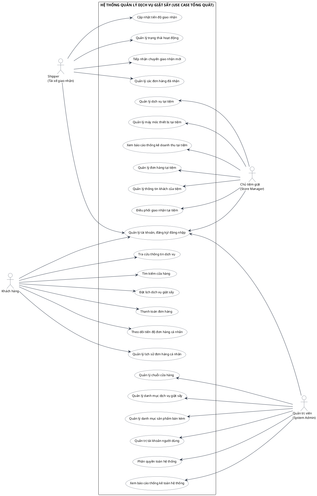
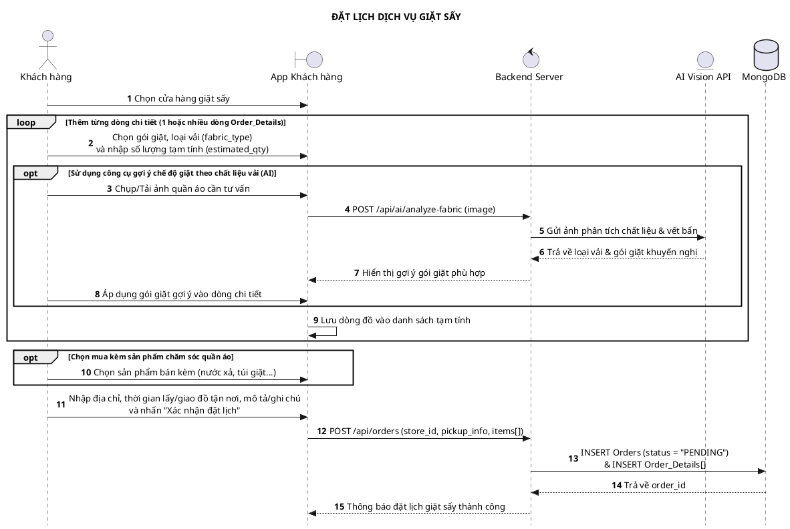
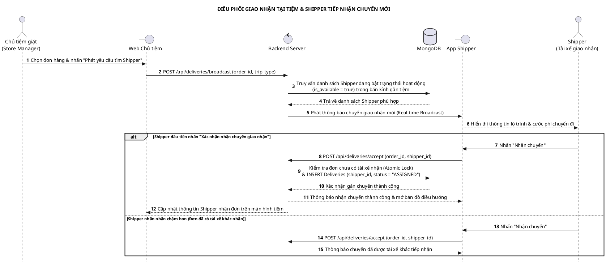
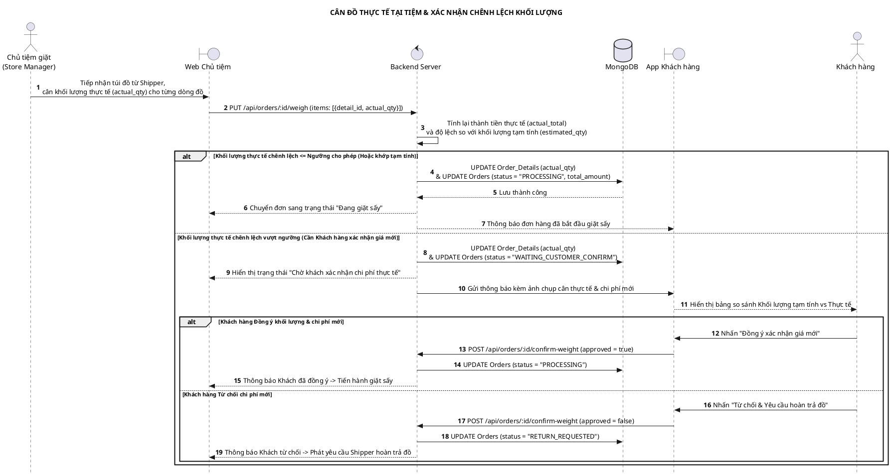

# TÀI LIỆU PHÂN TÍCH THIẾT KẾ HỆ THỐNG (UML USE CASE & SEQUENCE DIAGRAM)
**Dự án:** Hệ Thống Quản Lý Dịch Vụ Giặt Sấy Thông Minh (SạchSẽ / WashNow)

---

## PHẦN 1: QUY TẮC CHUẨN HÓA ĐÃ ÁP DỤNG (ĐÚNG 100% YÊU CẦU)

1. **Tuyệt đối không dùng dấu `"&"` để gộp chức năng:**
   - Mọi chức năng trong **Biểu đồ Use Case Tổng Quát** và **Biểu đồ Use Case Phân Rã** đều được tách riêng thành từng hình elip độc lập.
2. **Đồng nhất 100% tên Use Case từ Tổng Quát đến Phân Rã:**
   - Tên của từng Use Case trong **Biểu đồ Use Case Tổng Quát** trùng khớp từng chữ với **Use Case cha (cột giữa)** trong **Biểu đồ Use Case Phân Rã** của cả 4 Actor.
3. **Vẽ tách riêng từng cụm chức năng (Actor -> Use Case Cha -> Các Use Case Con) & Chống chồng chéo 100%:**
   - Đã cấu hình `skinparam nodesep 45`, `skinparam ranksep 130`, đóng khung từng cụm (`rectangle "Cụm ..."`) và khóa thứ tự dọc bằng liên kết ẩn `-[hidden]down-` để các hình elip và mũi tên `<<include>>` / `<<extend>>` thẳng hàng ngang từ trái sang phải, tuyệt đối không đè lên nhau.

---

## PHẦN 2: BẢNG ĐỐI CHIẾU ĐỒNG NHẤT TÊN USE CASE (TỔNG QUÁT <-> PHÂN RÃ)

### 2.1. Tác nhân 1: Khách hàng (7 cụm chức năng độc lập)

| Mã cụm | Tên Use Case ở Biểu đồ Tổng Quát | Tên Use Case Cha ở Biểu đồ Phân Rã (Đồng nhất 100%) | Các Use Case Con trong cụm Phân Rã (`<<include>>` / `<<extend>>`) |
| :--- | :--- | :--- | :--- |
| **KH-UC1** | Quản lý tài khoản, đăng ký/ đăng nhập | Quản lý tài khoản, đăng ký/ đăng nhập | • `<<extend>>` Đăng ký • `<<include>>` Đăng nhập • `<<extend>>` Quên mật khẩu • `<<extend>>` Thay đổi thông tin tài khoản |
| **KH-UC2** | Tra cứu thông tin dịch vụ | Tra cứu thông tin dịch vụ | • `<<include>>` Xem bảng giá dịch vụ giặt sấy • `<<extend>>` Xem danh mục sản phẩm chăm sóc quần áo • `<<extend>>` Ước tính chi phí giặt sấy tham khảo |
| **KH-UC3** | Tìm kiếm cửa hàng | Tìm kiếm cửa hàng | • `<<extend>>` Tìm kiếm theo ranking các cửa hàng • `<<extend>>` Định vị vị trí hiện tại trên bản đồ • `<<include>>` Tìm tiệm giặt gần nhất trên bản đồ |
| **KH-UC4** | Đặt lịch dịch vụ giặt sấy | Đặt lịch dịch vụ giặt sấy | • `<<include>>` Chọn cửa hàng giặt sấy • `<<include>>` Thêm từng dòng chi tiết: Chọn gói giặt, loại vải, số lượng tạm tính • `<<include>>` Nhập địa chỉ, thời gian lấy/giao đồ tận nơi, mô tả/ghi chú • `<<extend>>` Sử dụng công cụ gợi ý chế độ giặt theo chất liệu vải (AI) • `<<extend>>` Chọn mua kèm sản phẩm chăm sóc quần áo |
| **KH-UC5** | Thanh toán đơn hàng | Thanh toán đơn hàng | • `<<extend>>` Thanh toán tiền mặt khi nhận đồ (COD) • `<<extend>>` Thanh toán trực tuyến (Chuyển khoản / QR) |
| **KH-UC6** | Theo dõi tiến độ đơn hàng cá nhân | Theo dõi tiến độ đơn hàng cá nhân | • `<<include>>` Xem trạng thái xử lý giặt sấy • `<<include>>` Theo dõi lộ trình Shipper giao nhận • `<<extend>>` Xác nhận khối lượng và chi phí thực tế sau khi tiệm cân • `<<extend>>` Hủy đơn hàng (Khi đơn đang chờ xác nhận) |
| **KH-UC7** | Quản lý lịch sử đơn hàng cá nhân | Quản lý lịch sử đơn hàng cá nhân | • `<<include>>` Xem danh sách đơn hàng đã hoàn thành • `<<include>>` Xem chi tiết hóa đơn và từng dòng đồ giặt • `<<extend>>` Đánh giá chất lượng cửa hàng và tài xế • `<<extend>>` Đặt lại đơn giặt tương tự |

---

### 2.2. Tác nhân 2: Shipper (Tài xế giao nhận) (5 cụm chức năng độc lập)

| Mã cụm | Tên Use Case ở Biểu đồ Tổng Quát | Tên Use Case Cha ở Biểu đồ Phân Rã (Đồng nhất 100%) | Các Use Case Con trong cụm Phân Rã (`<<include>>` / `<<extend>>`) |
| :--- | :--- | :--- | :--- |
| **SP-UC1** | Quản lý tài khoản, đăng ký/ đăng nhập | Quản lý tài khoản, đăng ký/ đăng nhập | • `<<extend>>` Đăng ký tài khoản tài xế • `<<include>>` Đăng nhập • `<<extend>>` Quên mật khẩu • `<<extend>>` Thay đổi thông tin tài khoản và phương tiện |
| **SP-UC2** | Quản lý trạng thái hoạt động | Quản lý trạng thái hoạt động | • `<<include>>` Bật hoặc tắt trạng thái sẵn sàng nhận chuyến • `<<include>>` Cập nhật vị trí định vị GPS thời gian thực |
| **SP-UC3** | Tiếp nhận chuyến giao nhận mới | Tiếp nhận chuyến giao nhận mới | • `<<include>>` Xem danh sách chuyến phát sóng gần đây • `<<include>>` Xem chi tiết lộ trình và cước phí chuyến đi • `<<extend>>` Xác nhận nhận chuyến giao nhận • `<<extend>>` Từ chối hoặc bỏ qua chuyến phát sóng |
| **SP-UC4** | Quản lý các đơn hàng đã nhận | Quản lý các đơn hàng đã nhận | • `<<include>>` Xem danh sách đơn hàng đang thực hiện • `<<include>>` Xem bản đồ điều hướng đến điểm lấy hoặc giao đồ • `<<extend>>` Liên hệ khách hàng hoặc chủ tiệm giặt • `<<extend>>` Xem lịch sử chuyến giao nhận và ví thu nhập |
| **SP-UC5** | Cập nhật tiến độ giao nhận | Cập nhật tiến độ giao nhận | • `<<include>>` Xác nhận đã lấy đồ bẩn từ khách hàng • `<<include>>` Xác nhận đã bàn giao đồ cho tiệm giặt • `<<include>>` Xác nhận đã giao trả đồ sạch cho khách hàng • `<<extend>>` Xác nhận thu tiền mặt (COD) từ khách hàng |

---

### 2.3. Tác nhân 3: Chủ tiệm giặt (Store Manager) (7 cụm chức năng độc lập)

| Mã cụm | Tên Use Case ở Biểu đồ Tổng Quát | Tên Use Case Cha ở Biểu đồ Phân Rã (Đồng nhất 100%) | Các Use Case Con trong cụm Phân Rã (`<<include>>` / `<<extend>>`) |
| :--- | :--- | :--- | :--- |
| **SM-UC1** | Quản lý tài khoản, đăng ký/ đăng nhập | Quản lý tài khoản, đăng ký/ đăng nhập | • `<<include>>` Đăng nhập • `<<extend>>` Quên mật khẩu • `<<extend>>` Thay đổi thông tin tài khoản và hồ sơ tiệm |
| **SM-UC2** | Quản lý đơn hàng tại tiệm | Quản lý đơn hàng tại tiệm | • `<<include>>` Tiếp nhận đơn hàng mới và phân loại vải • `<<include>>` Cân khối lượng thực tế cho từng dòng đồ giặt • `<<extend>>` Gửi thông báo chênh lệch khối lượng chờ khách xác nhận • `<<include>>` Cập nhật tiến độ xử lý giặt, sấy, gấp gọn |
| **SM-UC3** | Quản lý thông tin khách của tiệm | Quản lý thông tin khách của tiệm | • `<<include>>` Tra cứu thông tin liên hệ khách hàng đặt đơn • `<<include>>` Xem lịch sử đặt giặt của khách tại tiệm • `<<extend>>` Ghi chú lưu ý chăm sóc vải riêng cho khách quen |
| **SM-UC4** | Điều phối giao nhận tại tiệm | Điều phối giao nhận tại tiệm | • `<<include>>` Phát yêu cầu tìm Shipper đi lấy đồ bẩn • `<<include>>` Phát yêu cầu tìm Shipper đi giao trả đồ sạch • `<<include>>` Xác nhận bàn giao túi đồ với Shipper tại quầy • `<<extend>>` Yêu cầu Shipper hoàn trả đồ khi khách từ chối giá mới |
| **SM-UC5** | Quản lý dịch vụ tại tiệm | Quản lý dịch vụ tại tiệm | • `<<include>>` Xem danh sách gói dịch vụ giặt sấy tại tiệm • `<<extend>>` Bật hoặc tắt trạng thái nhận khách của từng gói giặt • `<<extend>>` Cấu hình khung giờ nhận và trả đồ tại tiệm |
| **SM-UC6** | Quản lý máy móc thiết bị tại tiệm | Quản lý máy móc thiết bị tại tiệm | • `<<include>>` Theo dõi trạng thái hoạt động của máy giặt và máy sấy • `<<extend>>` Gán mẻ giặt của đơn hàng vào máy đang trống • `<<extend>>` Cập nhật trạng thái bảo trì hoặc báo hỏng thiết bị |
| **SM-UC7** | Xem báo cáo thống kê doanh thu tại tiệm | Xem báo cáo thống kê doanh thu tại tiệm | • `<<include>>` Xem thống kê doanh thu theo ngày, tuần, tháng • `<<include>>` Thống kê số lượng đơn hoàn thành tại tiệm • `<<extend>>` Xuất báo cáo kết quả kinh doanh của tiệm |

---

### 2.4. Tác nhân 4: Quản trị viên (System Admin) (7 cụm chức năng độc lập)

| Mã cụm | Tên Use Case ở Biểu đồ Tổng Quát | Tên Use Case Cha ở Biểu đồ Phân Rã (Đồng nhất 100%) | Các Use Case Con trong cụm Phân Rã (`<<include>>` / `<<extend>>`) |
| :--- | :--- | :--- | :--- |
| **AD-UC1** | Quản lý tài khoản, đăng ký/ đăng nhập | Quản lý tài khoản, đăng ký/ đăng nhập | • `<<include>>` Đăng nhập hệ thống quản trị • `<<extend>>` Quên mật khẩu • `<<extend>>` Thay đổi thông tin tài khoản quản trị |
| **AD-UC2** | Quản lý chuỗi cửa hàng | Quản lý chuỗi cửa hàng | • `<<include>>` Xem danh sách và trạng thái các chi nhánh cửa hàng • `<<extend>>` Thêm mới chi nhánh cửa hàng lên bản đồ • `<<extend>>` Cập nhật thông tin hoặc tạm ngưng chi nhánh • `<<extend>>` Gán chủ tiệm quản lý chi nhánh |
| **AD-UC3** | Quản lý danh mục dịch vụ giặt sấy | Quản lý danh mục dịch vụ giặt sấy | • `<<include>>` Xem danh sách gói dịch vụ giặt sấy toàn hệ thống • `<<extend>>` Thêm mới gói dịch vụ giặt sấy • `<<extend>>` Cập nhật đơn giá chuẩn theo kg hoặc theo món • `<<extend>>` Ẩn hoặc ngừng cung cấp gói dịch vụ |
| **AD-UC4** | Quản lý danh mục sản phẩm bán kèm | Quản lý danh mục sản phẩm bán kèm | • `<<include>>` Xem danh sách sản phẩm chăm sóc quần áo • `<<extend>>` Thêm mới sản phẩm nước giặt, nước xả, phụ kiện • `<<extend>>` Cập nhật giá bán và số lượng tồn kho • `<<extend>>` Xóa hoặc ngừng kinh doanh sản phẩm |
| **AD-UC5** | Quản trị tài khoản người dùng | Quản trị tài khoản người dùng | • `<<include>>` Xem danh sách tài khoản toàn hệ thống • `<<extend>>` Duyệt hồ sơ đăng ký đối tác Shipper và Chủ tiệm • `<<extend>>` Khóa hoặc mở khóa tài khoản người dùng |
| **AD-UC6** | Phân quyền toàn hệ thống | Phân quyền toàn hệ thống | • `<<include>>` Xem cấu hình vai trò người dùng • `<<extend>>` Cấp quyền Chủ tiệm giặt hoặc Shipper • `<<extend>>` Thu hồi hoặc thay đổi quyền truy cập tài khoản |
| **AD-UC7** | Xem báo cáo thống kê toàn hệ thống | Xem báo cáo thống kê toàn hệ thống | • `<<include>>` Xem báo cáo tổng hợp số lượng đơn hàng toàn chuỗi • `<<include>>` Thống kê doanh thu toàn hệ thống theo kỳ • `<<extend>>` Xuất báo cáo tổng hợp toàn hệ thống |

---

## PHẦN 3: CODE PLANTUML CHUẨN CHỐNG CHỒNG CHÉO (TỔNG QUÁT & 4 ACTOR PHÂN RÃ)

### 3.1. Biểu đồ Use Case Tổng Quát (Đã tách toàn bộ dấu "&", căn chỉnh khoảng cách rõ nét)

---

### 3.2. Biểu đồ Use Case Phân Rã - Khách Hàng (Chia đều 2 cột trong 1 khung hình vuông, không đè mũi tên)

```plantuml
@startuml
left to right direction
skinparam packageStyle rectangle
skinparam shadow false
skinparam nodesep 22
skinparam ranksep 65
skinparam defaultTextAlignment center
skinparam usecase {
  BackgroundColor #FFFFFF
  BorderColor #1E293B
  ArrowColor #1E293B
  FontSize 11
}
skinparam actor {
  BackgroundColor #FFFFFF
  BorderColor #1E293B
  FontSize 11
}
skinparam rectangle {
  BorderColor #1E293B
  FontSize 13
  FontStyle bold
}

actor "Khách hàng" as CUSTOMER_ACT_1
actor "Khách hàng" as CUSTOMER_ACT_2
actor "Khách hàng" as CUSTOMER_ACT_3
actor "Khách hàng" as CUSTOMER_ACT_4

CUSTOMER_ACT_1 -[hidden]down- CUSTOMER_ACT_2
CUSTOMER_ACT_2 -[hidden]down- CUSTOMER_ACT_3
CUSTOMER_ACT_3 -[hidden]down- CUSTOMER_ACT_4

rectangle "BIỂU ĐỒ USE CASE PHÂN RÃ - KHÁCH HÀNG" {
  ' ================= CỘT TRÁI (Cụm 1 -> Cụm 4) =================
  ' --- Cụm 1: Quản lý tài khoản, đăng ký/ đăng nhập ---
  usecase "Quản lý tài khoản,\nđăng ký/ đăng nhập" as CUSTOMER_UC1
  usecase "Đăng ký" as CUSTOMER_UC1_1
  usecase "Đăng nhập" as CUSTOMER_UC1_2
  usecase "Quên mật khẩu" as CUSTOMER_UC1_3
  usecase "Thay đổi thông tin\ntài khoản" as CUSTOMER_UC1_4

  CUSTOMER_ACT_1 --> CUSTOMER_UC1
  CUSTOMER_UC1 <.. CUSTOMER_UC1_1 : <<extend>>
  CUSTOMER_UC1 ..> CUSTOMER_UC1_2 : <<include>>
  CUSTOMER_UC1 <.. CUSTOMER_UC1_3 : <<extend>>
  CUSTOMER_UC1 <.. CUSTOMER_UC1_4 : <<extend>>

  ' --- Cụm 2: Tra cứu thông tin dịch vụ ---
  usecase "Tra cứu thông tin\ndịch vụ" as CUSTOMER_UC2
  usecase "Xem bảng giá dịch vụ\ngiặt sấy" as CUSTOMER_UC2_1
  usecase "Xem danh mục sản phẩm\nchăm sóc quần áo" as CUSTOMER_UC2_2
  usecase "Ước tính chi phí giặt\nsấy tham khảo" as CUSTOMER_UC2_3

  CUSTOMER_ACT_2 --> CUSTOMER_UC2
  CUSTOMER_UC2 ..> CUSTOMER_UC2_1 : <<include>>
  CUSTOMER_UC2 <.. CUSTOMER_UC2_2 : <<extend>>
  CUSTOMER_UC2 <.. CUSTOMER_UC2_3 : <<extend>>

  ' --- Cụm 3: Tìm kiếm cửa hàng ---
  usecase "Tìm kiếm cửa hàng" as CUSTOMER_UC3
  usecase "Tìm kiếm theo ranking\ncác cửa hàng" as CUSTOMER_UC3_1
  usecase "Định vị vị trí hiện tại\ntrên bản đồ" as CUSTOMER_UC3_2
  usecase "Tìm tiệm giặt gần nhất\ntrên bản đồ" as CUSTOMER_UC3_3

  CUSTOMER_ACT_3 --> CUSTOMER_UC3
  CUSTOMER_UC3 <.. CUSTOMER_UC3_1 : <<extend>>
  CUSTOMER_UC3 <.. CUSTOMER_UC3_2 : <<extend>>
  CUSTOMER_UC3 ..> CUSTOMER_UC3_3 : <<include>>

  ' --- Cụm 4: Đặt lịch dịch vụ giặt sấy ---
  usecase "Đặt lịch dịch vụ\ngiặt sấy" as CUSTOMER_UC4
  usecase "Chọn cửa hàng giặt sấy" as CUSTOMER_UC4_1
  usecase "Thêm từng dòng chi tiết:\nChọn gói giặt, loại vải,\nsố lượng tạm tính" as CUSTOMER_UC4_2
  usecase "Nhập địa chỉ, thời gian\nlấy/giao đồ tận nơi,\nmô tả/ghi chú" as CUSTOMER_UC4_3
  usecase "Sử dụng công cụ gợi ý\nchế độ giặt theo chất\nliệu vải (AI)" as CUSTOMER_UC4_4
  usecase "Chọn mua kèm sản phẩm\nchăm sóc quần áo" as CUSTOMER_UC4_5

  CUSTOMER_ACT_4 --> CUSTOMER_UC4
  CUSTOMER_UC4 ..> CUSTOMER_UC4_1 : <<include>>
  CUSTOMER_UC4 ..> CUSTOMER_UC4_2 : <<include>>
  CUSTOMER_UC4 ..> CUSTOMER_UC4_3 : <<include>>
  CUSTOMER_UC4 <.. CUSTOMER_UC4_4 : <<extend>>
  CUSTOMER_UC4 <.. CUSTOMER_UC4_5 : <<extend>>

  CUSTOMER_UC1 -[hidden]down- CUSTOMER_UC2
  CUSTOMER_UC2 -[hidden]down- CUSTOMER_UC3
  CUSTOMER_UC3 -[hidden]down- CUSTOMER_UC4

  ' ================= CỘT PHẢI (Cụm 5 -> Cụm 7) =================
  actor "Khách hàng" as CUSTOMER_ACT_5
  actor "Khách hàng" as CUSTOMER_ACT_6
  actor "Khách hàng" as CUSTOMER_ACT_7

  CUSTOMER_ACT_5 -[hidden]down- CUSTOMER_ACT_6
  CUSTOMER_ACT_6 -[hidden]down- CUSTOMER_ACT_7

  ' --- Cụm 5: Thanh toán đơn hàng ---
  usecase "Thanh toán đơn hàng" as CUSTOMER_UC5
  usecase "Thanh toán tiền mặt\nkhi nhận đồ (COD)" as CUSTOMER_UC5_1
  usecase "Thanh toán trực tuyến\n(Chuyển khoản / QR)" as CUSTOMER_UC5_2

  CUSTOMER_ACT_5 --> CUSTOMER_UC5
  CUSTOMER_UC5 <.. CUSTOMER_UC5_1 : <<extend>>
  CUSTOMER_UC5 <.. CUSTOMER_UC5_2 : <<extend>>

  ' --- Cụm 6: Theo dõi tiến độ đơn hàng cá nhân ---
  usecase "Theo dõi tiến độ đơn\nhàng cá nhân" as CUSTOMER_UC6
  usecase "Xem trạng thái xử lý\ngiặt sấy" as CUSTOMER_UC6_1
  usecase "Theo dõi lộ trình\nShipper giao nhận" as CUSTOMER_UC6_2
  usecase "Xác nhận khối lượng và\nchi phí thực tế sau\nkhi tiệm cân" as CUSTOMER_UC6_3
  usecase "Hủy đơn hàng (Khi đơn\nđang chờ xác nhận)" as CUSTOMER_UC6_4

  CUSTOMER_ACT_6 --> CUSTOMER_UC6
  CUSTOMER_UC6 ..> CUSTOMER_UC6_1 : <<include>>
  CUSTOMER_UC6 ..> CUSTOMER_UC6_2 : <<include>>
  CUSTOMER_UC6 <.. CUSTOMER_UC6_3 : <<extend>>
  CUSTOMER_UC6 <.. CUSTOMER_UC6_4 : <<extend>>

  ' --- Cụm 7: Quản lý lịch sử đơn hàng cá nhân ---
  usecase "Quản lý lịch sử đơn\nhàng cá nhân" as CUSTOMER_UC7
  usecase "Xem danh sách đơn hàng\nđã hoàn thành" as CUSTOMER_UC7_1
  usecase "Xem chi tiết hóa đơn\nvà từng dòng đồ giặt" as CUSTOMER_UC7_2
  usecase "Đánh giá chất lượng\ncửa hàng và tài xế" as CUSTOMER_UC7_3
  usecase "Đặt lại đơn giặt\ntương tự" as CUSTOMER_UC7_4

  CUSTOMER_ACT_7 --> CUSTOMER_UC7
  CUSTOMER_UC7 ..> CUSTOMER_UC7_1 : <<include>>
  CUSTOMER_UC7 ..> CUSTOMER_UC7_2 : <<include>>
  CUSTOMER_UC7 <.. CUSTOMER_UC7_3 : <<extend>>
  CUSTOMER_UC7 <.. CUSTOMER_UC7_4 : <<extend>>

  CUSTOMER_UC5 -[hidden]down- CUSTOMER_UC6
  CUSTOMER_UC6 -[hidden]down- CUSTOMER_UC7

  ' === Liên kết ẩn chia đều Cột Trái và Cột Phải trong 1 khung vuông ===
  CUSTOMER_UC1_2 -[hidden]--> CUSTOMER_ACT_5
  CUSTOMER_UC2_2 -[hidden]--> CUSTOMER_ACT_6
  CUSTOMER_UC3_2 -[hidden]--> CUSTOMER_ACT_7
}
@enduml
```

---

### 3.3. Biểu đồ Use Case Phân Rã - Shipper (Tài xế giao nhận) (Chia đều 2 cột trong 1 khung hình vuông)

```plantuml
@startuml
left to right direction
skinparam packageStyle rectangle
skinparam shadow false
skinparam nodesep 22
skinparam ranksep 65
skinparam defaultTextAlignment center
skinparam usecase {
  BackgroundColor #FFFFFF
  BorderColor #1E293B
  ArrowColor #1E293B
  FontSize 11
}
skinparam actor {
  BackgroundColor #FFFFFF
  BorderColor #1E293B
  FontSize 11
}
skinparam rectangle {
  BorderColor #1E293B
  FontSize 13
  FontStyle bold
}

actor "Shipper\n(Tài xế giao nhận)" as SHIPPER_ACT_1
actor "Shipper\n(Tài xế giao nhận)" as SHIPPER_ACT_2
actor "Shipper\n(Tài xế giao nhận)" as SHIPPER_ACT_3

SHIPPER_ACT_1 -[hidden]down- SHIPPER_ACT_2
SHIPPER_ACT_2 -[hidden]down- SHIPPER_ACT_3

rectangle "BIỂU ĐỒ USE CASE PHÂN RÃ - SHIPPER (TÀI XẾ GIAO NHẬN)" {
  ' ================= CỘT TRÁI (Cụm 1 -> Cụm 3) =================
  ' --- Cụm 1: Quản lý tài khoản, đăng ký/ đăng nhập ---
  usecase "Quản lý tài khoản,\nđăng ký/ đăng nhập" as SHIPPER_UC1
  usecase "Đăng ký tài khoản\ntài xế" as SHIPPER_UC1_1
  usecase "Đăng nhập" as SHIPPER_UC1_2
  usecase "Quên mật khẩu" as SHIPPER_UC1_3
  usecase "Thay đổi thông tin tài\nkhoản và phương tiện" as SHIPPER_UC1_4

  SHIPPER_ACT_1 --> SHIPPER_UC1
  SHIPPER_UC1 <.. SHIPPER_UC1_1 : <<extend>>
  SHIPPER_UC1 ..> SHIPPER_UC1_2 : <<include>>
  SHIPPER_UC1 <.. SHIPPER_UC1_3 : <<extend>>
  SHIPPER_UC1 <.. SHIPPER_UC1_4 : <<extend>>

  ' --- Cụm 2: Quản lý trạng thái hoạt động ---
  usecase "Quản lý trạng thái\nhoạt động" as SHIPPER_UC2
  usecase "Bật hoặc tắt trạng thái\nsẵn sàng nhận chuyến" as SHIPPER_UC2_1
  usecase "Cập nhật vị trí định vị\nGPS thời gian thực" as SHIPPER_UC2_2

  SHIPPER_ACT_2 --> SHIPPER_UC2
  SHIPPER_UC2 ..> SHIPPER_UC2_1 : <<include>>
  SHIPPER_UC2 ..> SHIPPER_UC2_2 : <<include>>

  ' --- Cụm 3: Tiếp nhận chuyến giao nhận mới ---
  usecase "Tiếp nhận chuyến\ngiao nhận mới" as SHIPPER_UC3
  usecase "Xem danh sách chuyến\nphát sóng gần đây" as SHIPPER_UC3_1
  usecase "Xem chi tiết lộ trình\nvà cước phí chuyến đi" as SHIPPER_UC3_2
  usecase "Xác nhận nhận chuyến\ngiao nhận" as SHIPPER_UC3_3
  usecase "Từ chối hoặc bỏ qua\nchuyến phát sóng" as SHIPPER_UC3_4

  SHIPPER_ACT_3 --> SHIPPER_UC3
  SHIPPER_UC3 ..> SHIPPER_UC3_1 : <<include>>
  SHIPPER_UC3 ..> SHIPPER_UC3_2 : <<include>>
  SHIPPER_UC3 <.. SHIPPER_UC3_3 : <<extend>>
  SHIPPER_UC3 <.. SHIPPER_UC3_4 : <<extend>>

  SHIPPER_UC1 -[hidden]down- SHIPPER_UC2
  SHIPPER_UC2 -[hidden]down- SHIPPER_UC3

  ' ================= CỘT PHẢI (Cụm 4 -> Cụm 5) =================
  actor "Shipper\n(Tài xế giao nhận)" as SHIPPER_ACT_4
  actor "Shipper\n(Tài xế giao nhận)" as SHIPPER_ACT_5

  SHIPPER_ACT_4 -[hidden]down- SHIPPER_ACT_5

  ' --- Cụm 4: Quản lý các đơn hàng đã nhận ---
  usecase "Quản lý các đơn hàng\nđã nhận" as SHIPPER_UC4
  usecase "Xem danh sách đơn hàng\nđang thực hiện" as SHIPPER_UC4_1
  usecase "Xem bản đồ điều hướng\nđến điểm lấy hoặc giao đồ" as SHIPPER_UC4_2
  usecase "Liên hệ khách hàng\nhoặc chủ tiệm giặt" as SHIPPER_UC4_3
  usecase "Xem lịch sử chuyến giao\nnhận và ví thu nhập" as SHIPPER_UC4_4

  SHIPPER_ACT_4 --> SHIPPER_UC4
  SHIPPER_UC4 ..> SHIPPER_UC4_1 : <<include>>
  SHIPPER_UC4 ..> SHIPPER_UC4_2 : <<include>>
  SHIPPER_UC4 <.. SHIPPER_UC4_3 : <<extend>>
  SHIPPER_UC4 <.. SHIPPER_UC4_4 : <<extend>>

  ' --- Cụm 5: Cập nhật tiến độ giao nhận ---
  usecase "Cập nhật tiến độ\ngiao nhận" as SHIPPER_UC5
  usecase "Xác nhận đã lấy đồ bẩn\ntừ khách hàng" as SHIPPER_UC5_1
  usecase "Xác nhận đã bàn giao\nđồ cho tiệm giặt" as SHIPPER_UC5_2
  usecase "Xác nhận đã giao trả\nđồ sạch cho khách hàng" as SHIPPER_UC5_3
  usecase "Xác nhận thu tiền mặt\n(COD) từ khách hàng" as SHIPPER_UC5_4

  SHIPPER_ACT_5 --> SHIPPER_UC5
  SHIPPER_UC5 ..> SHIPPER_UC5_1 : <<include>>
  SHIPPER_UC5 ..> SHIPPER_UC5_2 : <<include>>
  SHIPPER_UC5 ..> SHIPPER_UC5_3 : <<include>>
  SHIPPER_UC5 <.. SHIPPER_UC5_4 : <<extend>>

  SHIPPER_UC4 -[hidden]down- SHIPPER_UC5

  ' === Liên kết ẩn chia đều Cột Trái và Cột Phải trong 1 khung vuông ===
  SHIPPER_UC1_2 -[hidden]--> SHIPPER_ACT_4
  SHIPPER_UC2_2 -[hidden]--> SHIPPER_ACT_5
}
@enduml
```

---

### 3.4. Biểu đồ Use Case Phân Rã - Chủ Tiệm Giặt (Store Manager) (Chia đều 2 cột trong 1 khung hình vuông)

```plantuml
@startuml
left to right direction
skinparam packageStyle rectangle
skinparam shadow false
skinparam nodesep 22
skinparam ranksep 65
skinparam defaultTextAlignment center
skinparam usecase {
  BackgroundColor #FFFFFF
  BorderColor #1E293B
  ArrowColor #1E293B
  FontSize 11
}
skinparam actor {
  BackgroundColor #FFFFFF
  BorderColor #1E293B
  FontSize 11
}
skinparam rectangle {
  BorderColor #1E293B
  FontSize 13
  FontStyle bold
}

actor "Chủ tiệm giặt\n(Store Manager)" as STORE_ACT_1
actor "Chủ tiệm giặt\n(Store Manager)" as STORE_ACT_2
actor "Chủ tiệm giặt\n(Store Manager)" as STORE_ACT_3
actor "Chủ tiệm giặt\n(Store Manager)" as STORE_ACT_4

STORE_ACT_1 -[hidden]down- STORE_ACT_2
STORE_ACT_2 -[hidden]down- STORE_ACT_3
STORE_ACT_3 -[hidden]down- STORE_ACT_4

rectangle "BIỂU ĐỒ USE CASE PHÂN RÃ - CHỦ TIỆM GIẶT (STORE MANAGER)" {
  ' ================= CỘT TRÁI (Cụm 1 -> Cụm 4) =================
  ' --- Cụm 1: Quản lý tài khoản, đăng ký/ đăng nhập ---
  usecase "Quản lý tài khoản,\nđăng ký/ đăng nhập" as STORE_UC1
  usecase "Đăng nhập" as STORE_UC1_1
  usecase "Quên mật khẩu" as STORE_UC1_2
  usecase "Thay đổi thông tin tài\nkhoản và hồ sơ tiệm" as STORE_UC1_3

  STORE_ACT_1 --> STORE_UC1
  STORE_UC1 ..> STORE_UC1_1 : <<include>>
  STORE_UC1 <.. STORE_UC1_2 : <<extend>>
  STORE_UC1 <.. STORE_UC1_3 : <<extend>>

  ' --- Cụm 2: Quản lý đơn hàng tại tiệm ---
  usecase "Quản lý đơn hàng\ntại tiệm" as STORE_UC2
  usecase "Tiếp nhận đơn hàng mới\nvà phân loại vải" as STORE_UC2_1
  usecase "Cân khối lượng thực tế\ncho từng dòng đồ giặt" as STORE_UC2_2
  usecase "Gửi thông báo chênh lệch\nkhối lượng chờ khách\nxác nhận" as STORE_UC2_3
  usecase "Cập nhật tiến độ xử lý\ngiặt, sấy, gấp gọn" as STORE_UC2_4

  STORE_ACT_2 --> STORE_UC2
  STORE_UC2 ..> STORE_UC2_1 : <<include>>
  STORE_UC2 ..> STORE_UC2_2 : <<include>>
  STORE_UC2 <.. STORE_UC2_3 : <<extend>>
  STORE_UC2 ..> STORE_UC2_4 : <<include>>

  ' --- Cụm 3: Quản lý thông tin khách của tiệm ---
  usecase "Quản lý thông tin\nkhách của tiệm" as STORE_UC3
  usecase "Tra cứu thông tin liên\nhệ khách hàng đặt đơn" as STORE_UC3_1
  usecase "Xem lịch sử đặt giặt\ncủa khách tại tiệm" as STORE_UC3_2
  usecase "Ghi chú lưu ý chăm sóc\nvải riêng cho khách quen" as STORE_UC3_3

  STORE_ACT_3 --> STORE_UC3
  STORE_UC3 ..> STORE_UC3_1 : <<include>>
  STORE_UC3 ..> STORE_UC3_2 : <<include>>
  STORE_UC3 <.. STORE_UC3_3 : <<extend>>

  ' --- Cụm 4: Điều phối giao nhận tại tiệm ---
  usecase "Điều phối giao nhận\ntại tiệm" as STORE_UC4
  usecase "Phát yêu cầu tìm Shipper\nđi lấy đồ bẩn" as STORE_UC4_1
  usecase "Phát yêu cầu tìm Shipper\nđi giao trả đồ sạch" as STORE_UC4_2
  usecase "Xác nhận bàn giao túi đồ\nvới Shipper tại quầy" as STORE_UC4_3
  usecase "Yêu cầu Shipper hoàn trả\nđồ khi khách từ chối\ngiá mới" as STORE_UC4_4

  STORE_ACT_4 --> STORE_UC4
  STORE_UC4 ..> STORE_UC4_1 : <<include>>
  STORE_UC4 ..> STORE_UC4_2 : <<include>>
  STORE_UC4 ..> STORE_UC4_3 : <<include>>
  STORE_UC4 <.. STORE_UC4_4 : <<extend>>

  STORE_UC1 -[hidden]down- STORE_UC2
  STORE_UC2 -[hidden]down- STORE_UC3
  STORE_UC3 -[hidden]down- STORE_UC4

  ' ================= CỘT PHẢI (Cụm 5 -> Cụm 7) =================
  actor "Chủ tiệm giặt\n(Store Manager)" as STORE_ACT_5
  actor "Chủ tiệm giặt\n(Store Manager)" as STORE_ACT_6
  actor "Chủ tiệm giặt\n(Store Manager)" as STORE_ACT_7

  STORE_ACT_5 -[hidden]down- STORE_ACT_6
  STORE_ACT_6 -[hidden]down- STORE_ACT_7

  ' --- Cụm 5: Quản lý dịch vụ tại tiệm ---
  usecase "Quản lý dịch vụ\ntại tiệm" as STORE_UC5
  usecase "Xem danh sách gói dịch\nvụ giặt sấy tại tiệm" as STORE_UC5_1
  usecase "Bật hoặc tắt trạng thái\nnhận khách của từng\ngói giặt" as STORE_UC5_2
  usecase "Cấu hình khung giờ nhận\nvà trả đồ tại tiệm" as STORE_UC5_3

  STORE_ACT_5 --> STORE_UC5
  STORE_UC5 ..> STORE_UC5_1 : <<include>>
  STORE_UC5 <.. STORE_UC5_2 : <<extend>>
  STORE_UC5 <.. STORE_UC5_3 : <<extend>>

  ' --- Cụm 6: Quản lý máy móc thiết bị tại tiệm ---
  usecase "Quản lý máy móc\nthiết bị tại tiệm" as STORE_UC6
  usecase "Theo dõi trạng thái hoạt\nđộng của máy giặt và\nmáy sấy" as STORE_UC6_1
  usecase "Gán mẻ giặt của đơn hàng\nvào máy đang trống" as STORE_UC6_2
  usecase "Cập nhật trạng thái bảo\ntrì hoặc báo hỏng\nthiết bị" as STORE_UC6_3

  STORE_ACT_6 --> STORE_UC6
  STORE_UC6 ..> STORE_UC6_1 : <<include>>
  STORE_UC6 <.. STORE_UC6_2 : <<extend>>
  STORE_UC6 <.. STORE_UC6_3 : <<extend>>

  ' --- Cụm 7: Xem báo cáo thống kê doanh thu tại tiệm ---
  usecase "Xem báo cáo thống kê\ndoanh thu tại tiệm" as STORE_UC7
  usecase "Xem thống kê doanh thu\ntheo ngày, tuần, tháng" as STORE_UC7_1
  usecase "Thống kê số lượng đơn\nhoàn thành tại tiệm" as STORE_UC7_2
  usecase "Xuất báo cáo kết quả\nkinh doanh của tiệm" as STORE_UC7_3

  STORE_ACT_7 --> STORE_UC7
  STORE_UC7 ..> STORE_UC7_1 : <<include>>
  STORE_UC7 ..> STORE_UC7_2 : <<include>>
  STORE_UC7 <.. STORE_UC7_3 : <<extend>>

  STORE_UC5 -[hidden]down- STORE_UC6
  STORE_UC6 -[hidden]down- STORE_UC7

  ' === Liên kết ẩn chia đều Cột Trái và Cột Phải trong 1 khung vuông ===
  STORE_UC1_2 -[hidden]--> STORE_ACT_5
  STORE_UC2_2 -[hidden]--> STORE_ACT_6
  STORE_UC3_2 -[hidden]--> STORE_ACT_7
}
@enduml
```

---

### 3.5. Biểu đồ Use Case Phân Rã - Quản Trị Viên (System Admin) (Chia đều 2 cột trong 1 khung hình vuông)

```plantuml
@startuml
left to right direction
skinparam packageStyle rectangle
skinparam shadow false
skinparam nodesep 22
skinparam ranksep 65
skinparam defaultTextAlignment center
skinparam usecase {
  BackgroundColor #FFFFFF
  BorderColor #1E293B
  ArrowColor #1E293B
  FontSize 11
}
skinparam actor {
  BackgroundColor #FFFFFF
  BorderColor #1E293B
  FontSize 11
}
skinparam rectangle {
  BorderColor #1E293B
  FontSize 13
  FontStyle bold
}

actor "Quản trị viên\n(System Admin)" as ADMIN_ACT_1
actor "Quản trị viên\n(System Admin)" as ADMIN_ACT_2
actor "Quản trị viên\n(System Admin)" as ADMIN_ACT_3
actor "Quản trị viên\n(System Admin)" as ADMIN_ACT_4

ADMIN_ACT_1 -[hidden]down- ADMIN_ACT_2
ADMIN_ACT_2 -[hidden]down- ADMIN_ACT_3
ADMIN_ACT_3 -[hidden]down- ADMIN_ACT_4

rectangle "BIỂU ĐỒ USE CASE PHÂN RÃ - QUẢN TRỊ VIÊN (SYSTEM ADMIN)" {
  ' ================= CỘT TRÁI (Cụm 1 -> Cụm 4) =================
  ' --- Cụm 1: Quản lý tài khoản, đăng ký/ đăng nhập ---
  usecase "Quản lý tài khoản,\nđăng ký/ đăng nhập" as ADMIN_UC1
  usecase "Đăng nhập hệ thống\nquản trị" as ADMIN_UC1_1
  usecase "Quên mật khẩu" as ADMIN_UC1_2
  usecase "Thay đổi thông tin tài\nkhoản quản trị" as ADMIN_UC1_3

  ADMIN_ACT_1 --> ADMIN_UC1
  ADMIN_UC1 ..> ADMIN_UC1_1 : <<include>>
  ADMIN_UC1 <.. ADMIN_UC1_2 : <<extend>>
  ADMIN_UC1 <.. ADMIN_UC1_3 : <<extend>>

  ' --- Cụm 2: Quản lý chuỗi cửa hàng ---
  usecase "Quản lý chuỗi cửa hàng" as ADMIN_UC2
  usecase "Xem danh sách và trạng\nthái các chi nhánh\ncửa hàng" as ADMIN_UC2_1
  usecase "Thêm mới chi nhánh cửa\nhàng lên bản đồ" as ADMIN_UC2_2
  usecase "Cập nhật thông tin hoặc\ntạm ngưng chi nhánh" as ADMIN_UC2_3
  usecase "Gán chủ tiệm quản lý\nchi nhánh" as ADMIN_UC2_4

  ADMIN_ACT_2 --> ADMIN_UC2
  ADMIN_UC2 ..> ADMIN_UC2_1 : <<include>>
  ADMIN_UC2 <.. ADMIN_UC2_2 : <<extend>>
  ADMIN_UC2 <.. ADMIN_UC2_3 : <<extend>>
  ADMIN_UC2 <.. ADMIN_UC2_4 : <<extend>>

  ' --- Cụm 3: Quản lý danh mục dịch vụ giặt sấy ---
  usecase "Quản lý danh mục dịch\nvụ giặt sấy" as ADMIN_UC3
  usecase "Xem danh sách gói dịch\nvụ giặt sấy toàn\nhệ thống" as ADMIN_UC3_1
  usecase "Thêm mới gói dịch vụ\ngiặt sấy" as ADMIN_UC3_2
  usecase "Cập nhật đơn giá chuẩn\ntheo kg hoặc theo món" as ADMIN_UC3_3
  usecase "Ẩn hoặc ngừng cung cấp\ngói dịch vụ" as ADMIN_UC3_4

  ADMIN_ACT_3 --> ADMIN_UC3
  ADMIN_UC3 ..> ADMIN_UC3_1 : <<include>>
  ADMIN_UC3 <.. ADMIN_UC3_2 : <<extend>>
  ADMIN_UC3 <.. ADMIN_UC3_3 : <<extend>>
  ADMIN_UC3 <.. ADMIN_UC3_4 : <<extend>>

  ' --- Cụm 4: Quản lý danh mục sản phẩm bán kèm ---
  usecase "Quản lý danh mục sản\nphẩm bán kèm" as ADMIN_UC4
  usecase "Xem danh sách sản phẩm\nchăm sóc quần áo" as ADMIN_UC4_1
  usecase "Thêm mới sản phẩm nước\ngiặt, nước xả, phụ kiện" as ADMIN_UC4_2
  usecase "Cập nhật giá bán và\nsố lượng tồn kho" as ADMIN_UC4_3
  usecase "Xóa hoặc ngừng kinh\ndoanh sản phẩm" as ADMIN_UC4_4

  ADMIN_ACT_4 --> ADMIN_UC4
  ADMIN_UC4 ..> ADMIN_UC4_1 : <<include>>
  ADMIN_UC4 <.. ADMIN_UC4_2 : <<extend>>
  ADMIN_UC4 <.. ADMIN_UC4_3 : <<extend>>
  ADMIN_UC4 <.. ADMIN_UC4_4 : <<extend>>

  ADMIN_UC1 -[hidden]down- ADMIN_UC2
  ADMIN_UC2 -[hidden]down- ADMIN_UC3
  ADMIN_UC3 -[hidden]down- ADMIN_UC4

  ' ================= CỘT PHẢI (Cụm 5 -> Cụm 7) =================
  actor "Quản trị viên\n(System Admin)" as ADMIN_ACT_5
  actor "Quản trị viên\n(System Admin)" as ADMIN_ACT_6
  actor "Quản trị viên\n(System Admin)" as ADMIN_ACT_7

  ADMIN_ACT_5 -[hidden]down- ADMIN_ACT_6
  ADMIN_ACT_6 -[hidden]down- ADMIN_ACT_7

  ' --- Cụm 5: Quản trị tài khoản người dùng ---
  usecase "Quản trị tài khoản\nngười dùng" as ADMIN_UC5
  usecase "Xem danh sách tài khoản\ntoàn hệ thống" as ADMIN_UC5_1
  usecase "Duyệt hồ sơ đăng ký đối\ntác Shipper và Chủ tiệm" as ADMIN_UC5_2
  usecase "Khóa hoặc mở khóa tài\nkhoản người dùng" as ADMIN_UC5_3

  ADMIN_ACT_5 --> ADMIN_UC5
  ADMIN_UC5 ..> ADMIN_UC5_1 : <<include>>
  ADMIN_UC5 <.. ADMIN_UC5_2 : <<extend>>
  ADMIN_UC5 <.. ADMIN_UC5_3 : <<extend>>

  ' --- Cụm 6: Phân quyền toàn hệ thống ---
  usecase "Phân quyền toàn\nhệ thống" as ADMIN_UC6
  usecase "Xem cấu hình vai trò\nngười dùng" as ADMIN_UC6_1
  usecase "Cấp quyền Chủ tiệm giặt\nhoặc Shipper" as ADMIN_UC6_2
  usecase "Thu hồi hoặc thay đổi\nquyền truy cập tài khoản" as ADMIN_UC6_3

  ADMIN_ACT_6 --> ADMIN_UC6
  ADMIN_UC6 ..> ADMIN_UC6_1 : <<include>>
  ADMIN_UC6 <.. ADMIN_UC6_2 : <<extend>>
  ADMIN_UC6 <.. ADMIN_UC6_3 : <<extend>>

  ' --- Cụm 7: Xem báo cáo thống kê toàn hệ thống ---
  usecase "Xem báo cáo thống kê\ntoàn hệ thống" as ADMIN_UC7
  usecase "Xem báo cáo tổng hợp số\nlượng đơn hàng toàn chuỗi" as ADMIN_UC7_1
  usecase "Thống kê doanh thu toàn\nhệ thống theo kỳ" as ADMIN_UC7_2
  usecase "Xuất báo cáo tổng hợp\ntoàn hệ thống" as ADMIN_UC7_3

  ADMIN_ACT_7 --> ADMIN_UC7
  ADMIN_UC7 ..> ADMIN_UC7_1 : <<include>>
  ADMIN_UC7 ..> ADMIN_UC7_2 : <<include>>
  ADMIN_UC7 <.. ADMIN_UC7_3 : <<extend>>

  ADMIN_UC5 -[hidden]down- ADMIN_UC6
  ADMIN_UC6 -[hidden]down- ADMIN_UC7

  ' === Liên kết ẩn chia đều Cột Trái và Cột Phải trong 1 khung vuông ===
  ADMIN_UC1_2 -[hidden]--> ADMIN_ACT_5
  ADMIN_UC2_2 -[hidden]--> ADMIN_ACT_6
  ADMIN_UC3_2 -[hidden]--> ADMIN_ACT_7
}
@enduml
```

---

## PHẦN 4: 3 BIỂU ĐỒ SEQUENCE DIAGRAM CỐT LÕI

### 4.1. Sequence 1: Đặt lịch dịch vụ giặt sấy (Thể hiện rõ thao tác Thêm từng dòng đồ & Tùy chọn dùng AI)

---

### 4.2. Sequence 2: Điều phối giao nhận & Shipper nhận chuyến (Broadcast)

---

### 4.3. Sequence 3: Cân đồ thực tế tại tiệm & Xác nhận chênh lệch khối lượng với Khách hàng

